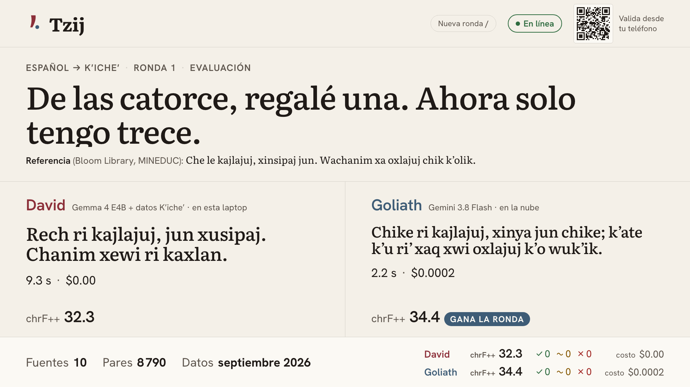
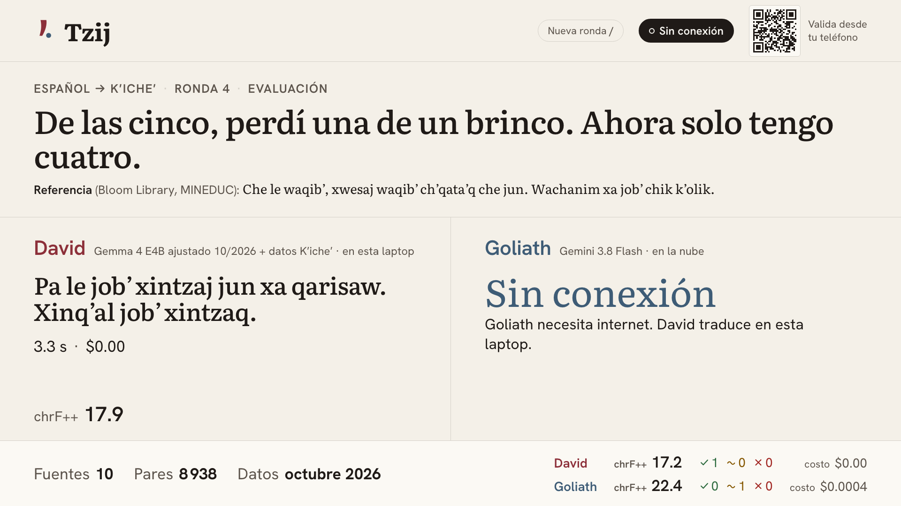

# Tzij — a Spanish ↔ K'iche' translator that works without internet

[Versión en español](README.md) · [Onboarding (Spanish)](docs/ONBOARDING.md) · [Logbook (Spanish)](docs/BITACORA.md) · [Demo script (Spanish)](docs/DEMO.md) · [Model card](MODEL_CARD.md) · [Sources](data/SOURCES.md) · [Evaluation report](evals/report.md)

Demo for the talk **"David vs. Goliath: cómo un modelo pequeño le gana a un modelo frontier"** ("David vs. Goliath: how a small model beats a frontier model").

Tzij ("word" in K'iche') translates between Spanish and K'iche' (ISO 639-3 `quc`), Guatemala's most widely spoken Mayan language. **David** is Gemma 4 E4B fine-tuned with LoRA (`tzij-2026-10-raft-bt-s3`) in Ollama on the laptop, with a hybrid retrieval index built only from licensed K'iche' data and MBR decoding. **Goliath** is Gemini 3.8 Flash on Vertex AI, used the way anyone would use it. On stage both translate the same phrase in parallel. A native speaker votes from their phone without knowing which model wrote each translation.

**The result, unvarnished:** Goliath translates better. David scores **21.5 chrF++** and Goliath **36.9**. David wins elsewhere: it costs **$0** per translation, the data never leaves the laptop, and it **works without internet**, where Goliath produces nothing. This repo is the half of the talk about *when NOT to fine-tune* and *what each step buys you*: retrieval and MBR decoding lift Gemma more than the fine-tune, which only helps together with MBR. Goliath teaches once in the cloud ($0.12 of back-translation) and David serves forever offline.



*Evaluation round. The sentence and its **reference** come from a Bloom Library book (MINEDUC Guatemala, CC BY 4.0). Both translations are **unvalidated model output**; chrF++ compares them with the reference. David took 2.7 s with 4 MBR samples (p50 in the report: 4.0 s) and Goliath 1.7 s.*



*Same kind of round with the network cut (rehearsal switch). David's translation is **unvalidated model output**.*

## What you'll learn

| Lesson | Where it lives in the code |
| --- | --- |
| **Licensed web data and orthography normalization.** Every record carries `origin=web`, a URL and a license. Sources that don't allow this use are left out. Typographic single quotes, the saltillo `ꞌ`, `ʼ` and the other characters used as a glottal stop are unified to the ASCII apostrophe before indexing, training or evaluating. | [`data/SOURCES.md`](data/SOURCES.md) (12 sources used, 14 needing permission, 28 rejected), [`pipeline/sources/`](pipeline/sources/), [`data/normalize.py`](data/normalize.py), [`tests/test_normalize.py`](tests/test_normalize.py) |
| **Split by source, not by sentence.** A source is either entirely test or entirely training, and any training pair that repeats a test sentence is dropped. A random sentence split would measure memory. | [`pipeline/split.py`](pipeline/split.py), [`pipeline/sources/__init__.py`](pipeline/sources/__init__.py), [`data/DATASHEET.md`](data/DATASHEET.md) |
| **An ablation decided by `make eval`.** Base + vectors → + hybrid retrieval → + RAFT fine-tune with back-translation → + MBR, plus Gemini with and without retrieval, on the same 600 sentences. Tuned on dev, measured on test once. The best local variant with p50 ≤ 5 s wins, even if it isn't the one that took the most work. | [`evals/run_eval.py`](evals/run_eval.py), [`evals/tune_retrieval.py`](evals/tune_retrieval.py), [`duel/tzij_duel/variants.py`](duel/tzij_duel/variants.py), [`evals/report.md`](evals/report.md) |
| **Hybrid retrieval.** BM25 (FTS5) for rare words and EmbeddingGemma for meaning, fused with RRF; exact and fuzzy glossary lookup; the closest example goes last, right next to the sentence. | [`rag/retrieve.py`](rag/retrieve.py), [`rag/store.py`](rag/store.py), [`evals/tuning.md`](evals/tuning.md) |
| **RAFT and back-translation: Goliath teaches once.** The fine-tune sees the same retrieved context David gets on stage, without its own answer. Gemini translates licensed monolingual K'iche' into Spanish, and those pairs train Spanish → K'iche' only (origin, model, prompt, seed and cost recorded). | [`pipeline/train_set.py`](pipeline/train_set.py), [`pipeline/monolingual.py`](pipeline/monolingual.py), [`pipeline/back_translate.py`](pipeline/back_translate.py) |
| **MBR.** 4 samples, and the one with the highest mean chrF++ against the others wins: the biggest single gain, paid for in latency. | [`duel/tzij_duel/variants.py`](duel/tzij_duel/variants.py) (`_mbr`) |
| **Token fertility.** In Gemma's tokenizer a K'iche' word costs 2.64 tokens and a Spanish word 1.41. The same sentence takes **1.92×** as many tokens in K'iche'. | [`evals/fertility.py`](evals/fertility.py), [`evals/fertility.md`](evals/fertility.md) |
| **Offline by design.** Model, embeddings, index, service and views all live on the laptop. Fonts are downloaded at build time. A 0.8 s TCP probe decides whether Goliath is online before calling it. | [`duel/duel_core/connectivity.py`](duel/duel_core/connectivity.py), [`rag/embedder.py`](rag/embedder.py), [`web/next.config.ts`](web/next.config.ts), [`duel/tzij_duel/main.py`](duel/tzij_duel/main.py) |
| **Automatic validation; native speakers optional.** Nobody has to review anything for the demo to work: each test pair is validated automatically (source-level split, cleaning, a 0.5–2.0 length ratio, the Spanish side looks Spanish, nothing repeated from train) and becomes `auto_validated`. Native review and the validator phone view are optional extras. | [`pipeline/validate_test.py`](pipeline/validate_test.py), [`pipeline/review.py`](pipeline/review.py) (optional), [`web/app/validar/page.tsx`](web/app/validar/page.tsx) (optional), [`evals/human_eval.md`](evals/human_eval.md) (optional) |

## Architecture


*The diagrams are labeled in Spanish, like the UI.*

- **On the laptop, inside the offline boundary:** the duel service (FastAPI on `:8787`) serves the API, the event stream (SSE) and both built views (`/presentador/` and `/validar/`). David runs in Ollama (`tzij-2026-10-raft-bt-s3`, a LoRA on Gemma 4 E4B). The index is a SQLite file with `sqlite-vec` (EmbeddingGemma vectors) and FTS5 (BM25).
- **On the LAN (optional):** if there is a validator, their phone opens the QR code on the presenter view and votes from there. The whole demo works without one: evaluation rounds are scored automatically with chrF++.
- **On Google Cloud:** Goliath (`gemini-3.8-flash` on Vertex AI, `global`) and two Cloud Run Jobs, one for the data and one for the GPU fine-tune. Their outputs land in Cloud Storage. The laptop only downloads datasets and models while preparing, never during the talk.

Diagram sources: [`docs/diagrams/`](docs/diagrams/) (HTML, SVG and PNG).

## Quickstart

Prerequisites and details are in [`docs/ONBOARDING.md`](docs/ONBOARDING.md). With Python 3.12, `uv`, Node 24, Ollama and `gcloud` installed:

```bash
cp .env.example .env                       # models, buckets and ports; .env is never committed
uv sync                                    # Python dependencies
ollama pull gemma4:e4b && ollama pull embeddinggemma
gcloud auth application-default login      # ADC for Vertex AI and Cloud Storage

make data-pull     # download the latest dataset from the bucket (or `make data` to build it here)
make index         # retrieval index with EmbeddingGemma + sqlite-vec + FTS5
make pull-model TAG=tzij-2026-10-raft-bt-s3   # the fine-tuned David (or LOCAL_MODEL_TAG=gemma4:e4b)
make web           # build the views (needs internet once, for the fonts)
make up            # Ollama + warmed-up David + service + views on the LAN
```

Open `http://127.0.0.1:8787/presentador/`. Scan the QR code with a phone. Press `E` for an evaluation phrase or `/` to type a live phrase.

To rehearse without the cloud or a GPU: `make up MOCK_AI=1`. Pass variables **after** `make`, because `.env` overrides environment variables. In mock mode David returns its best retrieved example from the licensed data and never makes up K'iche'. It still needs Ollama with `embeddinggemma` and the index.

## `make` commands

| Command | What it does |
| --- | --- |
| `make help` | Lists the commands. |
| `make data` | Runs the data pipeline locally: download, clean, normalize, dedupe, tag domains, split by source. Writes `data/processed/<version>/` and regenerates `data/DATASHEET.md`. |
| `make data-cloud` | Runs the same pipeline as a Cloud Run Job (`infra/10-data-job.sh`) and writes a versioned dataset to `gs://…-tzij-data/datasets/`. |
| `make data-pull` | Downloads the latest dataset the job produced. |
| `make index` | Builds `rag/index/tzij.sqlite` from the `train` split only, with EmbeddingGemma via Ollama. |
| `make review-test` | (Optional) Exports the test set to `data/review/test_review_<version>.csv` for a native review. |
| `make apply-review REVIEW_CSV=…` | Applies the verdicts (`ok` / `fix` / `reject`) to the test set. |
| `make fertility` | Measures K'iche' vs Spanish token fertility and writes `evals/fertility.md`. |
| `make datasheet` | Regenerates `data/DATASHEET.md` from the latest manifest. |
| `make tune-retrieval` | Tunes retrieval (mode, k, order, fuzzy glossary) on the dev split only and writes `evals/tuning.md`. |
| `make eval [EVAL_ARGS=…]` | Compares every available variant and writes `evals/report.md`. |
| `make human-eval-sheet` | Builds a blind human-evaluation sheet (50 sentences) from the latest eval run; `VARIANTS="gemma4:e4b+rag,gemini-3.8-flash"` picks variants. |
| `make train-data` | Renders the `train` sentences as chat JSONL (`data/train/chat.jsonl`). |
| `make train-data-raft` | Like `train-data`, but with retrieved context in every prompt, excluding the pair itself (RAFT): `data/train/chat-raft.jsonl`. |
| `make monolingual` | Licensed monolingual K'iche', from training-side sources only: `data/monolingual/quc.jsonl`. |
| `make back-translate` | Gemini translates that K'iche' into Spanish once and records the cost: `data/train/back_translated_gemini.jsonl`. |
| `make train-data-raft-bt` | RAFT data + back-translated pairs (Spanish → K'iche' only): `data/train/chat-raft-bt.jsonl`. |
| `make train TAG=tzij-YYYY-MM [TRAIN_ARGS=…]` | LoRA fine-tune as a Cloud Run Job on one L4. Records duration and cost in `train/runs/<tag>.json`. |
| `make train-local TAG=…` | The same training on the Mac (MPS), for when no cloud GPU is available. |
| `make train-finish TAG=…` | Merges a cloud-trained adapter and converts it to GGUF on the Mac, then publishes it to the models bucket. |
| `make pull-model TAG=…` | Downloads the GGUF from the bucket and registers it in Ollama. |
| `make web` | Builds the presenter and validator views (static export). |
| `make duel` | Runs only the duel service on `0.0.0.0:$DUEL_PORT`. |
| `make up` | (`MOCK_AI=1 make up`: no Ollama, index or dataset needed.) Starts Ollama if needed, warms David and EmbeddingGemma, builds the views if missing and serves everything on the LAN. |
| `make reset` | Clears rounds and verdicts, whether the service is running or not, in under 10 s. |
| `make test` | Python tests (`MOCK_AI=1`, no network) and web tests (vitest). |
| `make deploy` | Deploys the cloud parts (project, data job, training job and image). The duel and views stay on the laptop. |
| `make emulator` | Opens the validator in Chrome on the Android emulator (`10.0.2.2`) and fails if a vote takes more than 1 s to reach the screen. |
| `make screenshots` | Playwright screenshots of both views at 1920×1080 and 390×844 (the service must be running). |

`make deploy` deploys only what lives in the cloud: project setup (APIs, Artifact Registry, buckets, `hf-token` secret) via `infra/00-project.sh`, the data Cloud Run Job, and the training job with its image. **The duel service and the views are not deployed, on purpose:** they run on the laptop because the talk is about what works without internet.

## Repo map

```
data/          normalize.py (orthography), SOURCES.md, DATASHEET.md (generated)
pipeline/      run.py → sources/ (one per source) → clean.py → split.py → manifest/datasheet
               validate_test.py (automatic validation), review.py / apply_review.py (optional native review)
               train_set.py (chat JSONL, RAFT), monolingual.py + back_translate.py (back-translation)
               Dockerfile + cloudbuild.yaml (image for the data Cloud Run Job)
rag/           embedder.py (EmbeddingGemma via Ollama), store.py (sqlite-vec),
               build_index.py, retrieve.py (hybrid BM25 + vectors with RRF, examples + glossary)
duel/
  duel_core/   Ollama and Gemini clients, parallel duel, chrF++, cost, connectivity
  tzij_duel/   FastAPI service: variants.py, prompts.py, deck.py, rounds.py, model_card.py, lan.py
evals/         run_eval.py → report.md, tune_retrieval.py → tuning.md, fertility.py → fertility.md, human_eval.md
train/         train_lora.py (TRL + PEFT → merge → GGUF), submit_job.py (Cloud Run Job),
               finish_local.py, train_local.py, pull_model.sh, colab.ipynb, runs/
infra/         env.sh, 01-train-service-account.sh, 02-train-image.sh, 03-train-job.sh, 10-data-job.sh
web/           Next.js: app/presentador, app/validar, components/, lib/, tests/
tests/         pipeline, normalization, retrieval and fertility tests
docs/          ONBOARDING.md, diagrams/, screenshots/ (every translation in a screenshot is unvalidated model output)
MODEL_CARD.md  what David is, its data, results and limits
```

Generated files that are not committed: `data/raw/`, `data/processed/`, `data/review/`, `data/train/`, `rag/index/`, `evals/runs/`, `models/`, `web/out/`.

## Technical decisions

### What runs on the laptop, and why

| Component | Where | Why |
| --- | --- | --- |
| David (`tzij-2026-10-raft-bt-s3` in Ollama) | Laptop | The talk is about a model that serves a community without connectivity. If David needed internet, there would be no story. |
| Retrieval index (EmbeddingGemma + `sqlite-vec`) | Laptop | Queries run on stage with no network, so the index has to be built with the same embedding model that answers offline. The model name is stored inside the index and checked on every query (`rag/retrieve.py`). |
| Duel service (FastAPI) | Laptop | Calls David and Goliath in parallel, measures latency and cost, and stores rounds and verdicts in a JSON file. If the network drops, Goliath shows "sin conexión" (offline) and David carries on. |
| Presenter and validator views (Next.js, static export) | Laptop, served by the same process | One origin on the LAN: the phone only needs the laptop's IP. Fonts are downloaded at build time (`next/font`), so the page requests nothing from the internet. |
| Goliath (`gemini-3.8-flash`) | Vertex AI, `global` | The frontier model as people use it, with no extra data. It needs internet on purpose. |
| Data pipeline | Cloud Run Job (`us-central1`) | It downloads about 1.5 GB (the Wiktionary dump is streamed and filtered), it has to be reproducible, and it shouldn't depend on the presenter's laptop. It keeps the raw cache and versioned datasets in `gs://…-tzij-data`. `make data` runs the same code locally. |
| LoRA fine-tune | Cloud Run Job with 1× NVIDIA L4 (`europe-west4`) | Serverless, billed per second, nothing left running between retrains, and the same container idea as the pipeline. `TRAIN_RUNTIME=vertex` submits the same container as a Vertex AI Custom Job, and `train/colab.ipynb` wraps the same script for Colab Enterprise. |
| E4B merge and GGUF | Laptop (`make train-finish`) | See below. |

**The validator on the LAN.** The phone opens `http://<laptop IP>:8787/validar/` (the QR code works it out in `duel/tzij_duel/lan.py`, or you can pin it with `PUBLIC_URL`). It receives both translations in random order, with no name, latency or cost, and its vote shows up on the presenter view over SSE. On the Android emulator the laptop is `10.0.2.2`. `make emulator` checks that the vote arrives in under 1 s.

### Who can do what on the LAN

The service listens on `0.0.0.0` so the phone can reach it, so the API separates two audiences:

- **The presenter's laptop** (requests from `127.0.0.1`): start rounds, reset, simulate Wi-Fi off,
  read the full state and the `state` stream. That's why the presenter view is opened at
  `http://127.0.0.1:8787/presentador/`, not via the LAN IP. From any other machine these routes
  answer 403.
- **The phone:** only the `validator` stream and the verdict. The phone's stream is a separate
  subscriber set (`duel/tzij_duel/events.py`): it never receives model names, latency, cost or the
  reference, so the vote is truly blind, not just in the UI. A verdict is accepted only for the
  current live round and once per translation; evaluation rounds don't take votes (chrF++ scores
  them).

Discarded: username/password login. There's no time to sign in on stage, and what needs protecting
is who drives the show (the laptop), not who watches.

### Why the E4B merge/GGUF finishes on the laptop

A Cloud Run GPU job has at most **32 GiB** of memory, and its filesystem lives in that same memory. Training E4B fits: the LoRA adapter is saved to a Cloud Storage volume. What doesn't fit is saving the 16 GB merged checkpoint and converting it to GGUF. The `tzij-2026-09` run trained 324 steps in 1,316 s (22 min). Then it ran out of memory while saving the merged model (`train/runs/tzij-2026-09.json`, ~30 min of job time, ~$0.70 estimated). `make train-finish` downloads the adapter, merges it and converts it to GGUF Q4_K_M on the laptop with the same functions `train_lora.py` uses, then publishes the result to the models bucket. `make pull-model` doesn't care where the merge happened. A first run at 1.5 epochs was cancelled because, at ~4 s per step, it would not finish within Cloud Run's 1 h limit for a GPU task (`train/runs/failed/`).

RAFT prompts are longer (they carry the retrieved context), so one epoch doesn't fit in a 1 h task, and at batch 8 the L4 ran out of memory. `tzij-2026-10-raft-bt` trains with batch 2 × grad-accum 8, at most 1,024 tokens, in 4 chunks (`--shard i/4`): each chunk continues the previous chunk's adapter (`--init-adapter`). `make train-finish` merges the last one on the laptop, with a Q8_0 intermediate GGUF to save disk.

### BOUQuET: evaluation only, kept out of git

BOUQuET (Meta) is a multi-domain benchmark with human Spanish → K'iche' translations. It is gated on Hugging Face: you have to accept the terms, and the token lives in Secret Manager as `hf-token`. The terms allow **evaluation only** and private redistribution. So:

- it has the `test` role and never enters training or the index;
- its raw and processed data are gitignored and only exist in the private bucket;
- on-stage evaluation rounds exclude it (`duel/tzij_duel/deck.py`), so its sentences are never projected. `make eval` does use it, along with the Bloom books.

### The 30% cap on religious text

The Totonicapán New Testament contributes about 8,000 verses, far more than all the everyday sentences combined. Without a cap, David would translate "¿Dónde está el mercado?" ("Where is the market?") in the voice of a gospel. `pipeline/split.py` caps religious text at 30% of training sentences. It picks the verses with a stable hash, so the selection is reproducible and spread out, and it never puts religious text in the test set. `pipeline/train_set.py` checks the cap again before fine-tuning. In the current dataset the share is exactly 30.0%.

### No synthetic K'iche' (Gemini only writes Spanish)

Gemini does not master K'iche'. If it generated K'iche', it would teach David its own mistakes. Every K'iche' record is `origin=web`, with a URL and a license. The one controlled exception is back-translation: Gemini translates licensed monolingual K'iche' sentences into **Spanish** (`origin=back_translated_gemini`, with model, prompt, seed and cost in `data/train/back_translated_gemini.meta.json`). The K'iche' side stays 100% human-written, the pairs only train Spanish → K'iche', and they never enter the test set or the index. The sources that pair Spanish and K'iche' through English (Pontoon, GATITOS) are independent human translations, with no machine translation involved. Even mock mode (`MOCK_AI=1`) answers with text from the licensed data, never with made-up K'iche'. `HuggingFaceFW/finetranslations` was rejected because it is machine translation.

### EmbeddingGemma + `sqlite-vec`

- **Why:** they run locally and offline, in a single SQLite file that can be copied and is versioned per dataset. EmbeddingGemma is served by the same Ollama as David. It uses the task prefix `task: sentence similarity | query: ` because it compares input sentences with source sentences in the same language.
- **How:** two lookups per query. **Examples** come from a hybrid search: BM25 over FTS5 (finds rare words and names) and embedding neighbors (find meaning), fused with Reciprocal Rank Fusion and filtered by direction. The **glossary** first looks for exact matches of the whole input, its bigrams and its single words, then fuzzy matches (spelling variants), and fills up with the same hybrid search. David gets `RAG_K=6` of each kind, with the closest example last, right next to the sentence (`RAG_ORDER=best_last`, +1.7 on dev). All of it was tuned with `make tune-retrieval` on the dev split. An on-disk embedding cache (`rag/.cache/`) makes rebuilding cheap.
- **Rejected:** a cloud embedding API. It wouldn't work with the network cut, and the index has to be built with the same model that queries it.

### Other decisions

- **chrF++, not BLEU.** It gives partial credit for character n-grams in an agglutinative language with lots of spelling variation. It is computed at corpus level on normalized text, with the same apostrophe for everyone.
- **Same instructions for every model** (`tzij-translate-v1`). Only the context block changes, so the comparison measures data, not prompting.
- **David's latency includes retrieval**, because the audience waits for it too.
- **MBR on stage behind a flag.** With `MBR_ON_STAGE=1` David generates `MBR_SAMPLES=4` translations at temperature 0.7 and keeps the one with the highest mean chrF++ against the others. It's only on stage because p50 stays at 4.0 s (budget: 5 s). `MBR_ON_STAGE=0` goes back to a single sample.
- **`OLLAMA_NUM_CTX=4096`.** The 128k default reserves a huge KV cache and evicts EmbeddingGemma on every request.

## Results

`make eval`, run `final-20261002`, dataset `20261002-022500`. 600 test sentences (150 per source and direction, from Bloom and BOUQuET) that are never in the index or in training. References are `auto_validated` (`pipeline/validate_test.py`). Retrieval was tuned on the dev split only ([`evals/tuning.md`](evals/tuning.md)); the test set was used once, for these numbers.

| Variant | Where | Retrieval | es → quc | quc → es | Both | p50 | p95 | Cost / 1,000 |
| --- | --- | --- | ---: | ---: | ---: | ---: | ---: | ---: |
| Gemma 4 E4B (`gemma4:e4b`) | laptop | no | 7.5 | 16.7 | 11.7 | 1.31 s | 3.6 s | $0 |
| Gemma 4 E4B | laptop | vector | 18.2 | 18.8 | 18.5 | 1.84 s | 4.8 s | $0 |
| Gemma 4 E4B | laptop | hybrid | 19.0 | 19.8 | 19.4 | 1.75 s | 4.7 s | $0 |
| Gemma 4 E4B + MBR (4 samples) | laptop | hybrid | 20.4 | 20.9 | 20.7 | 4.59 s | 16.3 s | $0 |
| `tzij-2026-10-raft-bt-s3` (LoRA, RAFT + back-translation, 1 epoch) | laptop | no | 9.2 | 17.4 | 13.0 | 1.20 s | 4.6 s | $0 |
| `tzij-2026-10-raft-bt-s3` | laptop | hybrid | 18.4 | 18.3 | 18.3 | 1.72 s | 4.7 s | $0 |
| **`tzij-2026-10-raft-bt-s3` + MBR (4) — David on stage** | laptop | hybrid | 21.9 | 21.2 | **21.5** | 3.96 s | 14.2 s | $0 |
| **Gemini 3.8 Flash — Goliath** | cloud | no | 33.4 | 40.7 | **36.9** | 1.73 s | 4.7 s | $0.29 |
| Gemini 3.8 Flash | cloud | vector | 34.6 | 40.1 | 37.2 | 2.08 s | 6.5 s | $0.95 |

**Ablation: what each step bought** (same 600 sentences):

| Step | Both | Δ | p50 |
| --- | ---: | ---: | ---: |
| Base E4B + vector retrieval | 18.5 | — | 1.84 s |
| + hybrid retrieval (BM25 + vectors with RRF, fuzzy glossary, tuned on dev) | 19.4 | +0.9 | 1.75 s |
| + RAFT fine-tune with Gemini back-translation | 18.3 | −1.1 | 1.72 s |
| + MBR (4 samples; keep the one with the highest mean chrF++ against the others) | **21.5** | +3.2 | 3.96 s |


**The honest takeaway:**

- **Goliath is still the better translator.** David trails by 15.4 points overall and in every slice (length, direction, source, domain). It beats Goliath on 74 of 599 sentences (12%) and is within 5 points on 140 (23%). The gap shrank from 18 to 15.4 points since the first version.
- **Data is still what moves David.** Retrieval takes E4B from 11.7 to 18.5, and in Spanish → K'iche', the direction a model can't fake, from 7.5 to 18.2. Hybrid search adds +0.9: BM25 finds the rare words embeddings miss.
- **MBR is the biggest single gain (+3.2), paid for in latency.** David generates 4 translations and keeps the one most similar to the others. p50 goes from 1.7 to 4.0 s (inside the 5 s stage budget) and p95 to 14 s, so it can be turned off with `MBR_ON_STAGE=0`.
- **The fine-tune alone, with retrieval, did not help: −1.1.** RAFT trains with the same retrieved context David sees on stage, without the answer in it. Combined with MBR it does add +0.8 over the base model with MBR (21.5 vs 20.7): the tuned model produces more varied samples and MBR picks better among them. That's why the fine-tune goes on stage, but only together with MBR. It is worse than the base model on short phrases (13.7 vs 16.4).
- **Goliath teaches once in the cloud; David serves forever offline.** Gemini translated 405 licensed monolingual K'iche' sentences (K'iche' Wikipedia, Space Scoop) into Spanish: 399 pairs, used only for Spanish → K'iche', never in test or the index, for a one-time **$0.12**. The K'iche' side is still 100% human-written. At the same training budget (1/4 epoch) back-translation adds +1.1 (15.7 vs 14.6). The fine-tune cost **$3.09** across 5 L4 jobs.
- **Where David wins outright:** cost ($0 vs $0.29 per 1,000 translations, and Gemini's list price doubles on January 1, 2027), privacy (nothing leaves the laptop) and availability. With no internet Goliath produces nothing, and David's numbers don't change.
- Gemini with the same retrieval barely improves (36.9 → 37.2) and costs more than 3× as much because of the longer prompt.

Breakdown by source, length, domain and failures in [`evals/report.md`](evals/report.md). Token fertility in [`evals/fertility.md`](evals/fertility.md). Data and limits in [`MODEL_CARD.md`](MODEL_CARD.md).

## Versions

None of the preview APIs this talk series tracks (AppFunctions, WebMCP, UCP, AP2, A2A, MCP SDK, ADK) is used in this repo. Versions verified on September 30, 2026:

| Piece | Version |
| --- | --- |
| Goliath | `gemini-3.8-flash`, Vertex AI `global`, `thinking_level=low`, `google-genai` SDK 2.25.0 |
| David | `tzij-2026-10-raft-bt-s3` (LoRA on `google/gemma-4-E4B-it`, GGUF Q4_K_M) on Ollama 0.35.0 |
| Other `make eval` variants | `gemma4:e4b` (base), `tzij-2026-10-raft-bt-s0` and `tzij-2026-10-raft-s0` (1/4 epoch, to isolate back-translation) |
| Embeddings | `embeddinggemma` on Ollama |
| Python | 3.12 with uv 0.8.22: FastAPI 0.142.2, uvicorn 0.54.0, sacrebleu 2.6.0, sqlite-vec 0.1.9, tokenizers 0.23.2, huggingface-hub 1.33.0, google-cloud-storage 3.15.1, pytest 9.1.1 |
| Web | Node 24.21.0, npm 12.0.2, Next.js 16.3.8, React 19.3.0, TypeScript 5.9.3, vitest 3.2.7, Playwright 1.63.0 |
| Training image | torch 2.14.0 (CUDA 12.6), transformers 5.17.0, peft 0.21.1, trl 1.14.1, accelerate 1.15.0, datasets 5.0.1, llama.cpp `b11292` |
| Google Cloud SDK | 587.0.0 |

No model name is hard-coded: every model comes from `.env` (`GEMINI_MODEL`, `LOCAL_MODEL_TAG`, `BASE_MODEL_TAGS`, `FINETUNED_MODEL_TAGS`, `GEMMA_BASE_MODEL`, `EMBEDDING_MODEL`).

## Data: licenses and attribution

Every source, with owner, license, size, domain, orthography and status, is listed in [`data/SOURCES.md`](data/SOURCES.md). Per-source counts and drop reasons are in [`data/DATASHEET.md`](data/DATASHEET.md). Raw data is never committed: some licenses allow use but not redistribution.

| Source | Owner | License | Use |
| --- | --- | --- | --- |
| [Bloom Library K'iche' books](https://bloomlibrary.org/language:quc) (CC BY only) | Mostly Ministerio de Educación de Guatemala / USAID, via SIL Bloom Library | CC BY 4.0 per book; NC/ND books excluded | Test |
| [BOUQuET](https://huggingface.co/datasets/facebook/bouquet) | Meta FAIR and community translators | CC BY 4.0, gated; terms: evaluation only, private redistribution | Test (evaluation only) |
| [UD K'iche'-IU](https://github.com/UniversalDependencies/UD_Kiche-IU) | F. Tyers, R. Henderson (Indiana University) | CC BY-SA 4.0; sentences used with permission of the Academia de Lenguas Mayas de Guatemala and Telma Can Pixabaj | Training / index |
| [COERLL K'iche' course](https://tzij.coerll.utexas.edu/) | COERLL / LLILAS / AILLA, UT Austin | CC BY 4.0 | Training / index |
| [Universal Declaration of Human Rights](https://github.com/eric-muller/udhr) | OHCHR; XML from the UDHR in Unicode project | Free reproduction citing OHCHR as the source | Training / index |
| [Mozilla Pontoon](https://huggingface.co/datasets/ayymen/Pontoon-Translations) | Mozilla localization community; packaged by ayymen | MPL-2.0 | Training / index |
| [New Testament, K'iche' of Totonicapán](https://ebible.org/quctt/) + Biblia Libre para el Mundo | Pioneer Bible Translators (quc); BLM (es) | quc: CC BY 4.0 (© 2022 Pioneer Bible Translators); es: public domain | Training (max 30%) |
| [GATITOS](https://huggingface.co/datasets/google/smol) | Google Research (SMOL/GATITOS) | CC BY 4.0 | Lexicon |
| [PanLex](https://panlex.org/) | PanLex / Long Now Foundation; packaged by cointegrated | CC0 1.0 | Lexicon |
| [Spanish Wiktionary](https://es.wiktionary.org/) via [kaikki.org](https://kaikki.org/eswiktionary/) | Wiktionary contributors | CC BY-SA 4.0 | Lexicon |
| [K'iche' Wikipedia (Incubator `Wp/quc`)](https://incubator.wikimedia.org/wiki/Wp/quc) | Wikimedia contributors | CC BY-SA 4.0 | Monolingual K'iche' for back-translation (Spanish → K'iche' only) |
| [Space Scoop in K'iche'](https://www.unawe.org/kids/archive/lang/quc/viewall/) | Universe Awareness (UNAWE) / SpaceScoop.org | CC BY 4.0 (credit SpaceScoop.org) | Monolingual K'iche' for back-translation (Spanish → K'iche' only) |

Sources that require prior authorization (ALMG publications beyond the permitted examples, PLFM, SIL dictionaries, among others) are marked *needs permission* and are not used. K'iche' data belongs to its speakers and their institutions.
