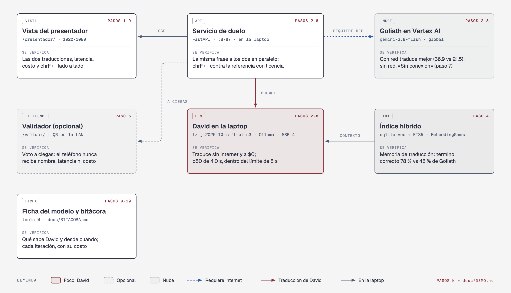

# Tzij — a Spanish ↔ K'iche' translator that works without internet

Demo for the talk **"David vs. Goliath: cómo un modelo pequeño le gana a un modelo frontier"** ("David vs. Goliath: how a small model beats a frontier model"). Tzij ("word" in K'iche') translates between Spanish and K'iche' (ISO 639-3 `quc`), Guatemala's most widely spoken Mayan language. **David** is Gemma 4 E4B fine-tuned with LoRA (`tzij-2026-10-mix-s7`) in Ollama on the laptop, with a hybrid retrieval index built only from licensed K'iche' data and MBR decoding. **Goliath** is Gemini 3.8 Flash on Vertex AI, used the way anyone would use it. On stage both translate the same phrase in parallel. **With an organization's translation memory, David beats Goliath**; in general translation, Goliath stays ahead. chrF++ scores each evaluation round against a licensed reference; if a speaker is in the room, they can vote from their phone without knowing which model wrote each translation.

The Spanish [README.md](README.md) is the primary document; this is a faithful English version.

## What you'll learn

1. **Licensed data and a split by source:** every K'iche' record carries a URL and a license, and a source is either entirely test or entirely training.
2. **What each step buys you:** retrieval is the biggest jump; the fine-tune started to pay off (+5.7) once its data looked like the test's domain.
3. **Goliath teaches once:** Gemini back-translates licensed K'iche' and writes distillation data for about $14, and David serves forever offline.
4. **A pre-registered niche:** with a translation memory Goliath lacks, David wins by +8.5 chrF++.
5. **Offline by design:** model, embeddings, index, service and views all live on the laptop.

## The result

| | David (laptop) | Goliath (cloud) |
| --- | ---: | ---: |
| **Specialty:** translation memory, Firefox Focus (144 sentences), chrF++ | **37.4** | 28.9 |
| General: `make eval`, 600 test sentences, chrF++ | 25.7 | **36.9** |
| Cost per 1,000 translations | **$0** | $0.29 |
| Without internet | **translates the same** | produces nothing |

On the specialty round David wins by +8.5 [95% CI: +4.7, +12.7] on a product he never saw. In general translation Goliath stays ahead by 11.2 points: the gap is general K'iche' ([logbook, section 10](docs/BITACORA.md), Spanish). Full table, ablation and takeaways in [docs/DECISIONES.en.md](docs/DECISIONES.en.md#results).

**What did not work** (details, numbers and cost in the [logbook](docs/BITACORA.md), Spanish):

- Fine-tune without the retrieval context: 0.8 points below the base model with retrieval (section 2).
- Dictionary-anchored synthetic data: 33.8 vs 34.2 on dev, left out of training (section 7).
- Logit bias toward the dictionary: −1.2 on dev against the same MBR without bias (section 8).
- More epochs and more Spanish → K'iche': a tie on dev, the David on stage does not change (section 9).




*The diagrams are labeled in Spanish, like the UI.*

## Quickstart

```bash
cp .env.example .env                       # models, buckets and ports; .env is never committed
uv sync && ollama pull gemma4:e4b && ollama pull embeddinggemma
gcloud auth application-default login      # ADC for Vertex AI and Cloud Storage
make data-pull && make niche-data && make web   # dataset with the specialty round, index and views
make pull-model TAG=tzij-2026-10-mix-s7 && make up
open http://127.0.0.1:8787/traductor/      # David's translator: type or tap an example
```

To rehearse without the cloud or a GPU: `make up MOCK_AI=1` ([details](docs/COMANDOS.en.md)).

## Documentation

- [docs/DEMO.en.md](docs/DEMO.en.md): demo script (David's translator) with screenshots, talk points and timings.
- [docs/ONBOARDING.md](docs/ONBOARDING.md): prerequisites, setup, cloud, data, training, tests, troubleshooting and talk-day checklist (Spanish).
- [docs/BITACORA.md](docs/BITACORA.md): David's story iteration by iteration, with costs, including what did not work (Spanish).
- [docs/DECISIONES.en.md](docs/DECISIONES.en.md): what the demo teaches in detail, every technical decision, full results and versions.
- [docs/COMANDOS.en.md](docs/COMANDOS.en.md): step-by-step setup and every `make` command.
- [docs/ESTRUCTURA.en.md](docs/ESTRUCTURA.en.md): what runs on the laptop, on the LAN and in the cloud, the pipeline and the repo map.
- [docs/CREDITOS.en.md](docs/CREDITOS.en.md): data sources, owners and licenses.
- [MODEL_CARD.md](MODEL_CARD.md): what David is, its data, results and limits.
- [evals/report.md](evals/report.md): evaluation report by source, length, domain and failures.
- [docs/diagrams/](docs/diagrams/): architecture, what the demo tests, pipeline, results and logbook (HTML, SVG and PNG).
- [data/SOURCES.md](data/SOURCES.md) and [data/DATASHEET.md](data/DATASHEET.md): sources and per-source counts.
