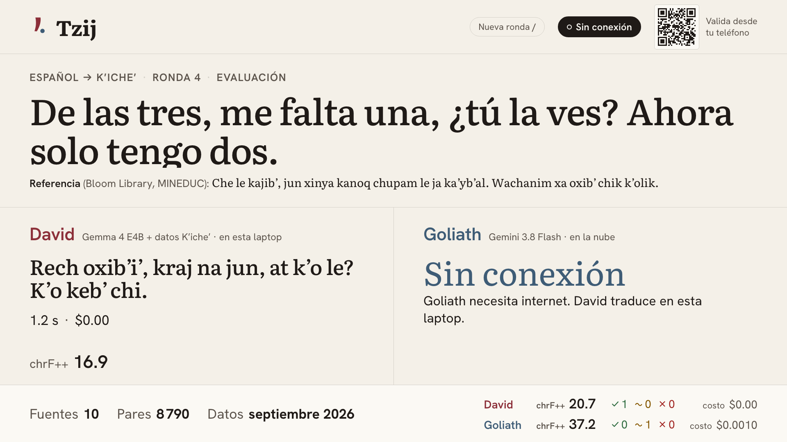

# Tzij — traductor español ↔ K'iche' que funciona sin internet

[English version](README.en.md) · [Onboarding](docs/ONBOARDING.md) · [Model card](MODEL_CARD.md) · [Fuentes](data/SOURCES.md) · [Reporte de evaluación](evals/report.md)

Demo de la charla **"David vs. Goliath: cómo un modelo pequeño le gana a un modelo frontier"**.

Tzij ("palabra" en K'iche') traduce entre español y K'iche' (ISO 639-3 `quc`), el idioma maya más hablado de Guatemala. **David** es Gemma 4 E4B en Ollama, en la laptop, con un índice de recuperación construido solo con datos K'iche' con licencia. **Goliath** es Gemini 3.8 Flash en Vertex AI, usado como lo usa cualquiera. Los dos traducen la misma frase en paralelo en el escenario. Una persona hablante nativa vota desde su teléfono sin saber qué modelo hizo cada traducción.

**El resultado, sin maquillaje:** Goliath traduce mejor. David saca **18.4 chrF++** y Goliath **36.4**. David gana en otras cosas: cuesta **$0** por traducción, los datos no salen de la laptop y **funciona sin internet**, donde Goliath no produce nada. Este repo es la mitad de la charla que responde a *cuándo NO hacer fine-tuning* y *qué compra la recuperación*: la recuperación le sube a Gemma más que el fine-tune, y el fine-tune no entra al escenario.



*Vista del presentador en una ronda de evaluación con la red cortada. La referencia viene de un libro de Bloom Library (MINEDUC, CC BY 4.0); las traducciones en pantalla son salidas de los modelos, no referencias.*

## Qué vas a aprender

| Lección | Dónde está en el código |
| --- | --- |
| **Datos web con licencia y normalización ortográfica.** Cada registro lleva `origin=web`, URL y licencia. Las fuentes que no lo permiten quedan fuera. Las comillas simples tipográficas, la saltillo `ꞌ`, el `ʼ` y otros caracteres que se usan como saltillo se unifican al apóstrofo ASCII antes de indexar, entrenar o evaluar. | [`data/SOURCES.md`](data/SOURCES.md) (10 fuentes usadas, 13 a la espera de permiso, 24 rechazadas), [`pipeline/sources/`](pipeline/sources/), [`data/normalize.py`](data/normalize.py), [`tests/test_normalize.py`](tests/test_normalize.py) |
| **Split por fuente, no por oración.** Una fuente entera es de prueba o entera de entrenamiento, y cualquier par de entrenamiento que repita una oración de prueba se descarta. Si las oraciones se repartieran al azar, la evaluación mediría memoria. | [`pipeline/split.py`](pipeline/split.py), [`pipeline/sources/__init__.py`](pipeline/sources/__init__.py), [`data/DATASHEET.md`](data/DATASHEET.md) |
| **Recuperación vs fine-tune, decidido por `make eval`.** Los seis tipos de variante (base, base + recuperación, fine-tune, fine-tune + recuperación, Gemini, Gemini + recuperación) sobre las mismas 600 frases. Gana la mejor variante local, aunque no sea la que costó más trabajo. | [`evals/run_eval.py`](evals/run_eval.py), [`duel/tzij_duel/variants.py`](duel/tzij_duel/variants.py), [`evals/report.md`](evals/report.md) |
| **Fertilidad de tokens.** En el tokenizador de Gemma, una palabra K'iche' cuesta 2.68 tokens y una española 1.45. La misma oración ocupa **1.88×** tokens en K'iche'. | [`evals/fertility.py`](evals/fertility.py), [`evals/fertility.md`](evals/fertility.md) |
| **Offline por diseño.** Modelo, embeddings, índice, servicio y vistas viven en la laptop. Las tipografías se descargan al compilar. Un sondeo TCP de 0.8 s decide si Goliath está en línea antes de llamarlo. | [`duel/duel_core/connectivity.py`](duel/duel_core/connectivity.py), [`rag/embedder.py`](rag/embedder.py), [`web/next.config.ts`](web/next.config.ts), [`duel/tzij_duel/main.py`](duel/tzij_duel/main.py) |
| **Validación con hablantes nativos.** El conjunto de prueba queda `pending_native_review` hasta que una persona lo revisa. En vivo, el veredicto lo da una persona desde su teléfono, a ciegas. Antes de cada evento se llena una plantilla de evaluación humana. | [`pipeline/review.py`](pipeline/review.py), [`pipeline/apply_review.py`](pipeline/apply_review.py), [`web/app/validar/page.tsx`](web/app/validar/page.tsx), [`evals/human_eval.md`](evals/human_eval.md) |

## Arquitectura


- **En la laptop, dentro del límite sin internet:** el servicio de duelo (FastAPI en `:8787`) sirve la API, el flujo de eventos (SSE) y las dos vistas compiladas (`/presentador/` y `/validar/`). David corre en Ollama (`gemma4:e4b`). El índice es un archivo SQLite con `sqlite-vec` y vectores de EmbeddingGemma.
- **En la LAN:** el teléfono de la persona validadora abre el QR que muestra la vista del presentador y vota desde ahí.
- **En Google Cloud:** Goliath (`gemini-3.8-flash` en Vertex AI, `global`) y dos Cloud Run Jobs, uno para los datos y otro para el fine-tune en GPU. Sus salidas quedan en Cloud Storage. La laptop solo baja datasets y modelos mientras se prepara, no durante la charla.

Fuente de los diagramas: [`docs/diagrams/`](docs/diagrams/) (HTML, SVG y PNG).

## Inicio rápido

Requisitos y detalles en [`docs/ONBOARDING.md`](docs/ONBOARDING.md). Con Python 3.12, `uv`, Node 24, Ollama y `gcloud` instalados:

```bash
cp .env.example .env                       # modelos, buckets y puertos; nunca se sube .env
uv sync                                    # dependencias de Python
ollama pull gemma4:e4b && ollama pull embeddinggemma
gcloud auth application-default login      # ADC para Vertex AI y Cloud Storage

make data-pull     # baja el último dataset del bucket (o `make data` para generarlo aquí)
make index         # índice de recuperación con EmbeddingGemma + sqlite-vec
make web           # compila las vistas (necesita internet una vez, por las tipografías)
make up            # Ollama + David precargado + servicio + vistas en la LAN
```

Abre `http://127.0.0.1:8787/presentador/`. Escanea el QR con el teléfono. Pulsa `E` para una frase de evaluación o `/` para escribir una frase en vivo.

Para ensayar sin la nube ni GPU: `make up MOCK_AI=1`. Las variables se pasan **después** de `make`, porque `.env` gana sobre las variables del entorno. En modo simulado David devuelve el mejor ejemplo recuperado de los datos con licencia y nunca inventa K'iche'. Todavía necesita Ollama con `embeddinggemma` y el índice.

## Comandos `make`

| Comando | Qué hace |
| --- | --- |
| `make help` | Lista los comandos. |
| `make data` | Corre el pipeline de datos en local: descarga, limpia, normaliza, deduplica, etiqueta dominios y separa por fuente. Escribe en `data/processed/<versión>/` y regenera `data/DATASHEET.md`. |
| `make data-cloud` | Corre el mismo pipeline como Cloud Run Job (`infra/10-data-job.sh`) y escribe un dataset versionado en `gs://…-tzij-data/datasets/`. |
| `make data-pull` | Baja el último dataset que produjo el job. |
| `make index` | Construye `rag/index/tzij.sqlite` solo con el split `train`, usando EmbeddingGemma vía Ollama. |
| `make review-test` | Exporta el conjunto de prueba a `data/review/test_review_<versión>.csv` para la revisión nativa. |
| `make apply-review REVIEW_CSV=…` | Aplica los veredictos (`ok` / `fix` / `reject`) al conjunto de prueba. |
| `make fertility` | Mide la fertilidad de tokens de K'iche' vs español y escribe `evals/fertility.md`. |
| `make datasheet` | Vuelve a generar `data/DATASHEET.md` desde el último manifest. |
| `make eval [EVAL_ARGS=…]` | Compara todas las variantes disponibles y escribe `evals/report.md`. |
| `make human-eval-sheet` | Genera una hoja de evaluación humana a ciegas (50 frases) a partir de la última corrida de eval. |
| `make train-data` | Convierte las oraciones de `train` en JSONL de chat (`data/train/chat.jsonl`). |
| `make train TAG=tzij-AAAA-MM [TRAIN_ARGS=…]` | Fine-tune LoRA como Cloud Run Job con una L4. Registra duración y costo en `train/runs/<tag>.json`. |
| `make train-local TAG=…` | El mismo entrenamiento en la Mac (MPS), por si no hay GPU en la nube. |
| `make train-finish TAG=…` | Hace el merge y el GGUF del adapter entrenado en la nube, en la Mac, y lo publica en el bucket de modelos. |
| `make pull-model TAG=…` | Baja el GGUF del bucket y lo registra en Ollama. |
| `make web` | Compila las vistas del presentador y del validador (export estático). |
| `make duel` | Levanta solo el servicio de duelo en `0.0.0.0:$DUEL_PORT`. |
| `make up` | Arranca Ollama si hace falta, precarga David y EmbeddingGemma, compila las vistas si faltan y sirve todo en la LAN. |
| `make reset` | Borra rondas y veredictos, con el servicio corriendo o no, en menos de 10 s. |
| `make test` | Pruebas de Python (`MOCK_AI=1`, sin red) y de la web (vitest). |
| `make emulator` | Abre el validador en Chrome del emulador Android (`10.0.2.2`) y falla si el voto tarda más de 1 s en llegar a la pantalla. |
| `make screenshots` | Capturas de Playwright de ambas vistas a 1920×1080 y 390×844 (el servicio debe estar corriendo). |

No hay `make deploy`. Nada de este proyecto se sirve desde la nube: lo que corre en la nube son los dos jobs (`make data-cloud`, `make train`).

## Mapa del repo

```
data/          normalize.py (ortografía), SOURCES.md, DATASHEET.md (generado)
pipeline/      run.py → sources/ (una por fuente) → clean.py → split.py → manifest/datasheet
               review.py / apply_review.py (revisión nativa), train_set.py (JSONL de chat)
               Dockerfile + cloudbuild.yaml (imagen del Cloud Run Job de datos)
rag/           embedder.py (EmbeddingGemma vía Ollama), store.py (sqlite-vec),
               build_index.py, retrieve.py (ejemplos + glosario)
duel/
  duel_core/   clientes de Ollama y Gemini, duelo en paralelo, chrF++, costo, conectividad
  tzij_duel/   servicio FastAPI: variants.py, prompts.py, deck.py, rounds.py, model_card.py, lan.py
evals/         run_eval.py → report.md, fertility.py → fertility.md, human_eval.md
train/         train_lora.py (TRL + PEFT → merge → GGUF), submit_job.py (Cloud Run Job),
               finish_local.py, train_local.py, pull_model.sh, colab.ipynb, runs/
infra/         env.sh, 01-train-service-account.sh, 02-train-image.sh, 03-train-job.sh, 10-data-job.sh
web/           Next.js: app/presentador, app/validar, components/, lib/, tests/
tests/         pruebas del pipeline, normalización, recuperación y fertilidad
docs/          ONBOARDING.md, diagrams/, screenshots/
MODEL_CARD.md  qué es David, con qué datos, resultados y límites
```

Archivos generados que no se suben a git: `data/raw/`, `data/processed/`, `data/review/`, `data/train/`, `rag/index/`, `evals/runs/`, `models/`, `web/out/`.

## Decisiones técnicas

### Qué corre en la laptop y por qué

| Componente | Dónde | Por qué |
| --- | --- | --- |
| David (`gemma4:e4b` en Ollama) | Laptop | La charla trata de un modelo que sirve a una comunidad sin conexión. Si David necesitara internet, no habría historia. |
| Índice de recuperación (EmbeddingGemma + `sqlite-vec`) | Laptop | Las consultas se hacen en el escenario sin red, así que el índice tiene que construirse con el mismo modelo de embeddings que responde offline. El nombre del modelo se guarda dentro del índice y se verifica en cada consulta (`rag/retrieve.py`). |
| Servicio de duelo (FastAPI) | Laptop | Llama a David y a Goliath en paralelo, mide latencia y costo, y guarda rondas y veredictos en un JSON. Si se va la red, Goliath aparece "sin conexión" y David sigue. |
| Vistas del presentador y del validador (Next.js, export estático) | Laptop, servidas por el mismo proceso | Un solo origen en la LAN: el teléfono solo necesita la IP de la laptop. Las tipografías se descargan al compilar (`next/font`), así que la página no pide nada a internet. |
| Goliath (`gemini-3.8-flash`) | Vertex AI, `global` | Es el modelo frontier tal como lo usa la gente, sin datos extra. Necesita internet a propósito. |
| Pipeline de datos | Cloud Run Job (`us-central1`) | Descarga unos 1.5 GB (el volcado de Wikcionario se filtra en streaming), tiene que ser reproducible y no debe depender de la laptop del presentador. Guarda la caché cruda y los datasets versionados en `gs://…-tzij-data`. `make data` corre el mismo código en local. |
| Fine-tune LoRA | Cloud Run Job con 1× NVIDIA L4 (`europe-west4`) | Sin servidores, se cobra por segundo, no queda nada encendido entre reentrenamientos, y usa la misma idea de contenedor que el pipeline. `TRAIN_RUNTIME=vertex` envía el mismo contenedor como Vertex AI Custom Job, y `train/colab.ipynb` envuelve el mismo script para Colab Enterprise. |
| Merge y GGUF del modelo E4B | Laptop (`make train-finish`) | Ver abajo. |

**El validador en la LAN.** El teléfono abre `http://<IP de la laptop>:8787/validar/` (el QR la calcula en `duel/tzij_duel/lan.py`, o se fija con `PUBLIC_URL`). Recibe las dos traducciones en orden aleatorio, sin nombre, latencia ni costo, y su voto aparece en la pantalla del presentador por SSE. En el emulador Android la laptop es `10.0.2.2`. `make emulator` comprueba que el voto llegue en menos de 1 s.

### Por qué el merge/GGUF de E4B termina en la laptop

Un Cloud Run Job con GPU tiene como máximo **32 GiB** de memoria, y su sistema de archivos vive en esa misma memoria. El entrenamiento de E4B cabe: el adapter LoRA se guarda en un volumen de Cloud Storage. Lo que no cabe es guardar el checkpoint fusionado de 16 GB y convertirlo a GGUF. La corrida `tzij-2026-09` entrenó 324 pasos en 1,316 s (22 min). Después se quedó sin memoria al guardar el modelo fusionado (`train/runs/tzij-2026-09.json`, ~30 min de job, ~$0.70 estimados). `make train-finish` baja el adapter, hace el merge y la conversión a GGUF Q4_K_M en la laptop con las mismas funciones de `train_lora.py`, y publica el resultado en el bucket de modelos. A `make pull-model` le da igual dónde se hizo el merge. Una primera corrida con 1.5 épocas se canceló porque, a ~4 s por paso, no terminaba dentro del límite de 1 h de una tarea de GPU en Cloud Run (`train/runs/failed/`).

### BOUQuET: solo evaluación y fuera de git

BOUQuET (Meta) es un benchmark multidominio con traducciones humanas español → K'iche'. Su acceso en Hugging Face está restringido: hay que aceptar los términos, y el token vive en Secret Manager como `hf-token`. Los términos permiten **solo evaluación** y redistribución privada. Por eso:

- tiene rol `test` y nunca entra al entrenamiento ni al índice;
- sus datos crudos y procesados están en `.gitignore` y solo existen en el bucket privado;
- las rondas de evaluación del escenario lo excluyen (`duel/tzij_duel/deck.py`), así que sus frases nunca se proyectan. `make eval` sí lo usa, junto con los libros de Bloom.

### Tope del 30 % para textos religiosos

El Nuevo Testamento de Totonicapán aporta unos 8,000 versículos, muchos más que todas las oraciones cotidianas juntas. Sin un tope, David traduciría "¿Dónde está el mercado?" con la voz de un evangelio. `pipeline/split.py` limita los textos religiosos al 30 % de las oraciones de entrenamiento. Elige los versículos con un hash estable, para que la selección sea reproducible y repartida, y nunca pone textos religiosos en prueba. `pipeline/train_set.py` vuelve a comprobar el tope antes del fine-tune. En el dataset actual la proporción es exactamente 30.0 %.

### Sin K'iche' sintético

Gemini no domina el K'iche'. Si generara datos de entrenamiento, le enseñaría a David sus propios errores. Cada registro es `origin=web`, con URL y licencia. Las fuentes que unen español y K'iche' a través del inglés (Pontoon, GATITOS) son traducciones humanas independientes, sin traducción automática. Hasta el modo simulado (`MOCK_AI=1`) responde con textos de los datos con licencia, nunca con K'iche' inventado. Se descartó `HuggingFaceFW/finetranslations` por ser traducción automática.

### EmbeddingGemma + `sqlite-vec`

- **Por qué:** corren en local, offline, en un solo archivo SQLite que se copia y se versiona por dataset. EmbeddingGemma se sirve desde el mismo Ollama que David. Usa el prefijo de tarea `task: sentence similarity | query: ` porque compara frases de entrada con frases fuente del mismo idioma.
- **Cómo:** dos búsquedas por consulta. Los **ejemplos** son los pares de oraciones más cercanos por embedding, filtrados por dirección. El **glosario** busca primero coincidencias exactas de la entrada completa, de bigramas y de palabras sueltas, porque los embeddings son débiles con palabras aisladas; después completa con las entradas de diccionario más cercanas por embedding. David recibe `RAG_K=6` de cada tipo. Hay una caché de embeddings en disco (`rag/.cache/`) que abarata la reconstrucción.
- **Descartado:** una API de embeddings en la nube. No funcionaría con la red cortada, y el índice tiene que construirse con el mismo modelo que consulta.

### Otras decisiones

- **chrF++ y no BLEU.** Da crédito parcial por n-gramas de caracteres en un idioma aglutinante con mucha variación ortográfica. Se calcula a nivel corpus sobre texto normalizado, con el mismo apóstrofo para todos.
- **Mismas instrucciones para todos los modelos** (`tzij-translate-v1`). Solo cambia el bloque de contexto, así que la comparación mide datos y no prompts.
- **La latencia de David incluye la recuperación**, porque el público también espera por ella.
- **`OLLAMA_NUM_CTX=4096`.** El contexto por defecto de 128k reserva una caché KV enorme y saca a EmbeddingGemma de memoria en cada petición.

## Resultados

`make eval`, corrida `full-20260930`, dataset `20260930-220035`. Son 600 frases de prueba (150 por fuente y dirección, de Bloom y BOUQuET) que nunca están en el índice. Las referencias siguen `pending_native_review`, así que los números son provisionales.

| Variante | Dónde | Recuperación | es → quc | quc → es | Ambas | p50 | Costo / 1,000 |
| --- | --- | --- | ---: | ---: | ---: | ---: | ---: |
| Gemma 4 E2B (`gemma4:e2b-it-qat`) | laptop | no | 8.4 | 11.4 | 9.8 | 0.85 s | $0 |
| Gemma 4 E2B | laptop | sí | 15.1 | 15.9 | 15.4 | 0.84 s | $0 |
| Gemma 4 E4B (`gemma4:e4b`) | laptop | no | 7.4 | 16.3 | 11.5 | 1.20 s | $0 |
| **Gemma 4 E4B — David en escena** | laptop | sí | 18.0 | 18.9 | **18.4** | 1.73 s | $0 |
| `tzij-2026-09` (LoRA sobre E4B, 1 época) | laptop | no | 13.8 | 16.8 | 15.2 | 1.07 s | $0 |
| `tzij-2026-09` | laptop | sí | 17.5 | 17.8 | 17.6 | 1.75 s | $0 |
| **Gemini 3.8 Flash — Goliath** | nube | no | 32.8 | 40.4 | **36.4** | 1.83 s | $0.26 |
| Gemini 3.8 Flash | nube | sí | 34.3 | 40.4 | 37.2 | 2.29 s | $1.00 |


**La conclusión honesta:**

- **Goliath es mejor traductor.** David queda 18 puntos abajo en el total y en todos los cortes (longitud, dirección, dominio). Supera a Goliath en 45 de 598 oraciones (8 %) y queda a menos de 5 puntos en 110 (18 %).
- **La recuperación es lo que mueve a David.** Con unas 7,000 entradas de diccionario y pares de ejemplo por dirección, E4B pasa de 11.5 a 18.4 (+60 %) y E2B de 9.8 a 15.4. En español → K'iche', la dirección que un modelo no puede improvisar, E4B **más que duplica** su puntaje (7.4 → 18.0).
- **El fine-tune ayudó menos que la recuperación.** Una época de LoRA sobre 2,590 pares de oraciones sube a E4B de 11.5 a 15.2 (+3.7), contra +6.9 de la recuperación. Combinado con la recuperación queda 0.8 puntos *por debajo* de E4B + recuperación. Es mejor en frases cortas (13.9 vs 11.2) y peor en oraciones largas. Con menos de 2,000 pares no religiosos, la recuperación es la mejor inversión: el fine-tune se queda en el reporte, no en el escenario. El dataset sí pasa el umbral para fine-tune (2,701 pares de oraciones limpias fuera de prueba, mínimo 2,000). Que esté permitido no significa que convenga.
- **Donde David gana sin discusión:** costo ($0 contra $0.26 por cada 1,000 traducciones, y la tarifa de lista de Gemini se duplica desde el 1 de enero de 2027), privacidad (nada sale de la laptop) y disponibilidad. Sin internet Goliath no produce nada, y los números de David no cambian.
- Gemini con la misma recuperación mejora poco (36.4 → 37.2) y cuesta casi 4 veces más por el prompt más largo.

Detalle por fuente, longitud, dominio y fallos en [`evals/report.md`](evals/report.md). Fertilidad de tokens en [`evals/fertility.md`](evals/fertility.md). Datos y límites en [`MODEL_CARD.md`](MODEL_CARD.md).

## Versiones

Ninguna API en preview de las que sigue la serie de charlas (AppFunctions, WebMCP, UCP, AP2, A2A, MCP SDK, ADK) se usa en este repo. Versiones verificadas el 30 de septiembre de 2026:

| Pieza | Versión |
| --- | --- |
| Goliath | `gemini-3.8-flash`, Vertex AI `global`, `thinking_level=low`, SDK `google-genai` 2.25.0 |
| David | `gemma4:e4b` en Ollama 0.35.0 |
| Otras variantes de `make eval` | `gemma4:e2b-it-qat`, `tzij-2026-09` (LoRA sobre `google/gemma-4-E4B-it`, GGUF Q4_K_M) |
| Embeddings | `embeddinggemma` en Ollama |
| Python | 3.12 con uv 0.8.22: FastAPI 0.142.2, uvicorn 0.54.0, sacrebleu 2.6.0, sqlite-vec 0.1.9, tokenizers 0.23.2, huggingface-hub 1.33.0, google-cloud-storage 3.15.1, pytest 9.1.1 |
| Web | Node 24.21.0, npm 12.0.2, Next.js 16.3.8, React 19.3.0, TypeScript 5.9.3, vitest 3.2.7, Playwright 1.63.0 |
| Imagen de entrenamiento | torch 2.14.0 (CUDA 12.6), transformers 5.17.0, peft 0.21.1, trl 1.14.1, accelerate 1.15.0, datasets 5.0.1, llama.cpp `b11292` |
| Google Cloud SDK | 587.0.0 |

Ningún nombre de modelo está escrito en el código: todos vienen de `.env` (`GEMINI_MODEL`, `LOCAL_MODEL_TAG`, `BASE_MODEL_TAGS`, `FINETUNED_MODEL_TAGS`, `GEMMA_BASE_MODEL`, `EMBEDDING_MODEL`).

## Datos: licencias y atribución

Cada fuente, con dueño, licencia, tamaño, dominio, ortografía y estado, está en [`data/SOURCES.md`](data/SOURCES.md). Los conteos por fuente y las razones de descarte están en [`data/DATASHEET.md`](data/DATASHEET.md). Los datos crudos nunca se suben a git: algunas licencias permiten usarlos pero no redistribuirlos.

| Fuente | Dueño | Licencia | Uso |
| --- | --- | --- | --- |
| [Bloom Library, libros K'iche'](https://bloomlibrary.org/language:quc) (solo CC BY) | Principalmente Ministerio de Educación de Guatemala / USAID, vía SIL Bloom Library | CC BY 4.0 por libro; se excluyen los NC/ND | Prueba |
| [BOUQuET](https://huggingface.co/datasets/facebook/bouquet) | Meta FAIR y traductores de la comunidad | CC BY 4.0, acceso restringido; términos: solo evaluación, redistribución privada | Prueba (solo evaluación) |
| [UD K'iche'-IU](https://github.com/UniversalDependencies/UD_Kiche-IU) | F. Tyers, R. Henderson (Indiana University) | CC BY-SA 4.0; oraciones usadas con permiso de la Academia de Lenguas Mayas de Guatemala y de Telma Can Pixabaj | Entrenamiento / índice |
| [COERLL, curso de K'iche'](https://tzij.coerll.utexas.edu/) | COERLL / LLILAS / AILLA, UT Austin | CC BY 4.0 | Entrenamiento / índice |
| [Declaración Universal de Derechos Humanos](https://github.com/eric-muller/udhr) | OHCHR; XML del proyecto UDHR in Unicode | Reproducción libre citando a OHCHR como fuente | Entrenamiento / índice |
| [Mozilla Pontoon](https://huggingface.co/datasets/ayymen/Pontoon-Translations) | Comunidad de localización de Mozilla; empaquetado por ayymen | MPL-2.0 | Entrenamiento / índice |
| [Nuevo Testamento, K'iche' de Totonicapán](https://ebible.org/quctt/) + Biblia Libre para el Mundo | Pioneer Bible Translators (quc); BLM (es) | quc: CC BY 4.0 (© 2022 Pioneer Bible Translators); es: dominio público | Entrenamiento (máx. 30 %) |
| [GATITOS](https://huggingface.co/datasets/google/smol) | Google Research (SMOL/GATITOS) | CC BY 4.0 | Léxico |
| [PanLex](https://panlex.org/) | PanLex / Long Now Foundation; empaquetado por cointegrated | CC0 1.0 | Léxico |
| [Wikcionario](https://es.wiktionary.org/) vía [kaikki.org](https://kaikki.org/eswiktionary/) | Colaboradores de Wikcionario | CC BY-SA 4.0 | Léxico |

Las fuentes que piden autorización previa (publicaciones de la ALMG fuera de los ejemplos permitidos, PLFM, diccionarios del SIL, entre otras) están marcadas como *needs permission* y no se usan. Los datos K'iche' pertenecen a sus hablantes y a sus instituciones.
