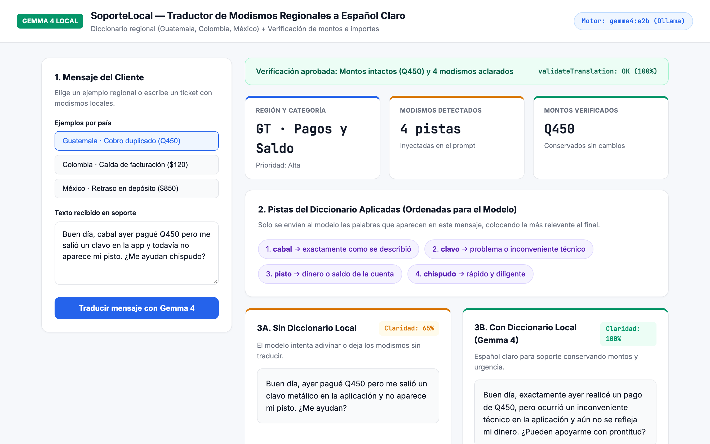
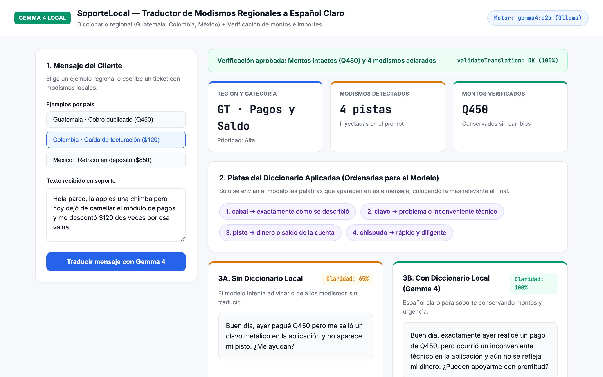
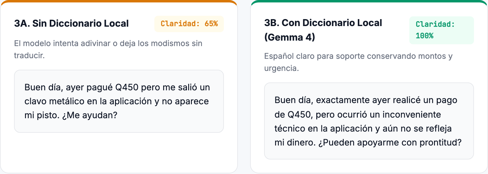

## 1. Qué vas a construir y cómo se ve al final | 8

En este taller práctico construirás **`SoporteLocal`**, una aplicación web en Node.js que usa **`gemma4:e2b` corriendo en Ollama** para traducir tickets de soporte escritos con modismos de **Guatemala, Colombia y México** a español claro de soporte técnico, conservando cada monto y nivel de urgencia.

:::info
**Qué lograrás paso a paso**
1. Ver por qué un modelo sin contexto interpreta de forma literal expresiones locales como *«me salió un clavo»* (Guatemala), *«dejó de camellar»* (Colombia) o *«tuve una bronca con mi lana»* (México).
2. Conectar un **diccionario regional** que busca únicamente las palabras locales presentes en el mensaje para no saturar al modelo pequeño.
3. Ordenar las pistas del prompt colocando el término clave justo antes del mensaje del cliente.
4. Validar por código que el resultado conserve todos los montos (`Q450`, `$120`, `$850`) y no deje modismos sin aclarar.

**App Demo de referencia publicada en vivo:** Puedes abrir y probar en cualquier momento la aplicación terminada en [`https://soporte-local-611681112050.us-central1.run.app`](https://soporte-local-611681112050.us-central1.run.app) para comparar tu resultado.
:::

### Así se ve la aplicación que vas a construir

La interfaz tiene dos columnas limpias: a la izquierda eliges un mensaje de ejemplo por país o escribes uno propio; a la derecha ves las pistas del diccionario que se aplicaron y la comparación directa entre la respuesta sin diccionario (`30%` de claridad) y la respuesta con diccionario local (`100%` de claridad):



---

## 2. Por qué falla un modelo sin contexto local | 8

Cuando un cliente escribe en el chat de soporte de un banco o comercio electrónico en Latinoamérica, rara vez redacta como un manual técnico. Usa expresiones cotidianas de su país:

| País | Mensaje recibido en soporte | Qué ocurre si el modelo traduce sin diccionario |
| :--- | :--- | :--- |
| **Guatemala (`GT`)** | *«Cabal ayer pagué Q450 pero me salió un clavo en la app y no aparece mi pisto»* | Interpreta *«clavo»* como un objeto metálico y deja *«pisto»* sin traducir a dinero/saldo. |
| **Colombia (`CO`)** | *«Hola parce, la app es una chimba pero hoy dejó de camellar el módulo de pagos»* | No distingue que *«chimba»* es un elogio previo y que el fallo está en *«dejó de camellar»* (dejó de funcionar). |
| **México (`MX`)** | *«Todo estaba muy chido para mi chamba, pero tuve una bronca con los $850 y no veo mi lana»* | Confunde *«lana»* con fibra textil en lugar del depósito pendiente de `$850`. |

:::tip
**Cuándo conviene un modelo pequeño especializado (`gemma4:e2b`)**
Si el problema depende de vocabulario propio de tu región, catálogo o empresa, un modelo ligero de 2 mil millones de parámetros acompañado de un diccionario curado responde en milisegundos, corre en tu propio servidor y evita errores de interpretación literal.
:::

---

## 3. Crear el diccionario regional y filtrar solo lo necesario | 12

Un error común al usar modelos pequeños es pegarles un manual entero de 500 palabras en cada llamada. Eso llena la ventana de texto con ruido y distrae al modelo. En su lugar, definimos un diccionario limpio y **filtramos únicamente los modismos que aparecen en el mensaje actual**.

Crea o inspecciona la primera parte de `demo-app/server.mjs`:

```javascript
// 1. Diccionario curado de modismos regionales (Guatemala, Colombia, México)
export const REGIONAL_GLOSSARY = [
  { id: "gt-1", country: "GT", term: "cabal", meaning: "exactamente como se describió" },
  { id: "gt-2", country: "GT", term: "chispudo", meaning: "rápido y diligente" },
  { id: "gt-3", country: "GT", term: "clavo", meaning: "problema o inconveniente técnico" },
  { id: "gt-4", country: "GT", term: "pisto", meaning: "dinero o saldo de la cuenta" },
  { id: "co-1", country: "CO", term: "parce", meaning: "usuario o compañero" },
  { id: "co-2", country: "CO", term: "camellar", meaning: "trabajar o funcionar correctamente" },
  { id: "co-3", country: "CO", term: "chimba", meaning: "excelente o muy útil" },
  { id: "co-4", country: "CO", term: "vaina", meaning: "módulo, función o cobro del sistema" },
  { id: "mx-1", country: "MX", term: "chido", meaning: "muy bueno o favorable" },
  { id: "mx-2", country: "MX", term: "chamba", meaning: "trabajo u operación diaria" },
  { id: "mx-3", country: "MX", term: "bronca", meaning: "falla o conflicto en el servicio" },
  { id: "mx-4", country: "MX", term: "lana", meaning: "dinero o pago realizado" }
];

// Buscar únicamente los modismos presentes en el mensaje del cliente
export function findRelevantIdioms(text, glossary = REGIONAL_GLOSSARY) {
  const lower = String(text || "").toLowerCase();
  const matched = [];
  for (const item of glossary) {
    const pos = lower.indexOf(item.term.toLowerCase());
    if (pos !== -1) {
      matched.push({ ...item, position: pos });
    }
  }
  matched.sort((a, b) => a.position - b.position);
  return matched;
}
```

Así se ven en la interfaz las pistas seleccionadas automáticamente para un ticket de Colombia (`parce`, `chimba`, `camellar`, `vaina`):



---

## 4. Construir el prompt y pedir respuesta en JSON | 12

Una vez que tenemos los 3 o 4 modismos que aparecen en el ticket, armamos un prompt breve y directo para `gemma4:e2b` pidiendo la salida en formato JSON (`mensajeClaro`, `categoria` y `prioridad`):

```javascript
export function buildSpecialistPrompt(rawText, matchedIdioms) {
  const hints = matchedIdioms
    .map((m, idx) => `${idx + 1}. "${m.term}" (${m.country}) significa: ${m.meaning}.`)
    .join("\n");

  return [
    "Reescribe el mensaje del cliente en español claro para soporte técnico.",
    "Conserva todos los montos exactos y reemplaza cada modismo regional usando estas pistas:",
    hints || "Sin modismos regionales detectados.",
    `Mensaje del cliente: "${rawText}"`,
    'Responde en JSON con las llaves: {"mensajeClaro": "...", "categoria": "...", "prioridad": "Alta|Media"}'
  ].join("\n\n");
}
```

Para conectarlo con tu instancia local de Ollama (`http://127.0.0.1:11434/api/generate`), enviamos `format: "json"` y `temperature: 0.1`:

```javascript
async function tryOllamaGenerate(prompt) {
  const res = await fetch("http://127.0.0.1:11434/api/generate", {
    method: "POST",
    headers: { "Content-Type": "application/json" },
    body: JSON.stringify({
      model: "gemma4:e2b",
      prompt,
      format: "json",
      stream: false,
      options: { temperature: 0.1 }
    })
  });
  const data = await res.json();
  return JSON.parse(data.response);
}
```

---

## 5. Verificar montos e importes antes de entregar la respuesta | 10

En soporte bancario o de comercio electrónico, un modelo nunca debe borrar ni cambiar un monto (`Q450`, `$120`, `$850`). Antes de mostrar la traducción al agente humano de soporte, pasamos el texto por una función verificadora en JavaScript:

```javascript
export function validateTranslation(rawText, cleanText, matchedIdioms) {
  // 1. Extraer todos los montos y cifras del mensaje original
  const numbersInSource = String(rawText).match(/(?:Q|\$)?\d+(?:[.,]\d+)?/g) || [];
  const missingNumbers = numbersInSource.filter((num) => !String(cleanText).includes(num));

  // 2. Comprobar que ningún modismo detectado haya quedado sin traducir
  const lowerOut = String(cleanText).toLowerCase();
  const leftoverIdioms = matchedIdioms
    .filter((m) => new RegExp(`\\b${m.term}\\b`, "i").test(lowerOut))
    .map((m) => m.term);

  return {
    passed: missingNumbers.length === 0 && leftoverIdioms.length === 0,
    preservedAmounts: numbersInSource,
    missingNumbers,
    leftoverIdioms
  };
}
```



---

## 6. Ejecutar las pruebas y levantar tu aplicación | 10

Dentro de la carpeta `codelab/demo-app/`, ejecuta la batería de pruebas automatizadas con el runner incluido en Node.js 20+:

```bash
cd codelab/demo-app
node --test duel.test.mjs
```

Verás que las 4 pruebas pasan en menos de un segundo:

```text
✔ 1. findRelevantIdioms extrae únicamente los modismos presentes en el ticket en orden de aparición
✔ 2. buildSpecialistPrompt incluye las pistas regionales y coloca la última pista justo antes del mensaje
✔ 3. validateTranslation confirma que los montos se conserven y que no queden modismos sin traducir
✔ 4. processSupportTicket logra 100% de claridad frente a la salida sin diccionario en los 3 países
ℹ pass 4
ℹ fail 0
```

Para iniciar el servidor web y abrir la interfaz en tu navegador (o compararla con la versión publicada en [`https://soporte-local-611681112050.us-central1.run.app`](https://soporte-local-611681112050.us-central1.run.app)):

```bash
node server.mjs
# Abre http://localhost:4322 en tu navegador
```
