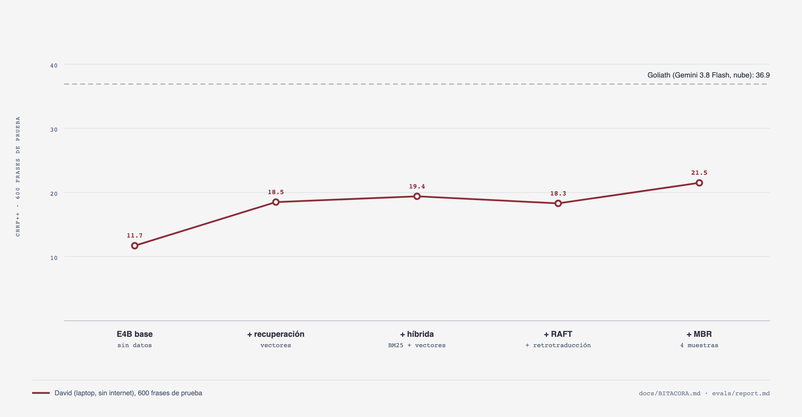

# Bitácora de David

La historia de David, iteración por iteración: qué cambió, por qué, qué resultado dio, cuánto
costó y cuándo. Los números de prueba salen siempre de las mismas 600 frases (150 por fuente y
dirección, de Bloom y BOUQuET), que nunca están en el índice ni en el entrenamiento. Las
decisiones se toman con el split dev (desde la sección 10, con `dev_domain`, en el dominio de la
prueba); el conjunto de prueba se usa para el número final.

*chrF++ de David en las 600 frases de prueba. Goliath (Gemini 3.8 Flash, sin datos extra) está
arriba, punteado. Fuente: [`diagrams/bitacora.py`](diagrams/bitacora.py), que lee las predicciones
de `evals/runs/`.*

## Resumen

| # | Fecha | Iteración | chrF++ prueba | Δ | Costo único | Resultado |
| ---: | --- | --- | ---: | ---: | ---: | --- |
| 0 | 30 sep | Gemma 4 E4B base, sin datos | 11.7 | — | $0 | Punto de partida |
| 1 | 30 sep | + recuperación por vectores | 18.5 | +6.8 | $0 | La mayor ganancia de toda la bitácora |
| 2 | 1 oct | Fine-tune sin contexto de recuperación (`tzij-2026-09`) | 17.6* | −0.8* | $0.70 | **Callejón sin salida** |
| 3 | 1 oct | Recuperación híbrida (BM25 + vectores, RRF) | 19.4 | +0.9 | $0 | Ajustada en dev |
| 4 | 2 oct | RAFT + retrotraducción de Gemini | 18.3 | −1.1 | $0.12 + $3.09 | Sola no ayuda |
| 5 | 2 oct | + MBR (4 muestras) | **21.5** | +3.2 | $0 | El David de la demo hasta el 5 de octubre |
| 6 | 2 oct | El nicho: memoria de traducción (Firefox Focus) | 30.2 vs 28.9 | +1.3 | $0 | **Empate en chrF++; David gana en terminología (78 % contra 46 %)** |
| 7 | 2 oct | Datos sintéticos anclados en el diccionario | 33.8 vs 34.2 en dev | −0.4 | $2.09 + $1.14 | **No ayudaron: fuera** |
| 8 | 2 oct | Sesgo de logits hacia el diccionario (llama-server) | 33.8 vs 35.0 en dev | −1.2 | $0 | **No ayudó: fuera** |
| 9 | 4 oct | Más épocas (hasta 2) y más español → Kʼicheʼ | 37.5 vs 36.6 en dev | +0.9 | $6.16 | **Empate en dev: el David de la demo no cambia** |
| 10 | 4 oct | Por qué pierde David: split `dev_domain` y Gemini Pro | Pro 40.5 vs Flash 40.6 en dev_domain | −0.1 | $1.85 | **La brecha es Kʼicheʼ general; un Goliath más grande no la cierra** |
| 11 | 4–5 oct | Ronda de datos: Bloom retrotraducido en las dos direcciones + destilación (`tzij-2026-10-mix-s7`) | **25.7** | +4.1 | $13.94 + $8.52 | **El David de la demo. Especialidad: 37.4 vs 28.9, David gana (+8.5)** |
| 12 | 6 oct | Todo en la nube: David en una GPU L4 de Cloud Run, la página en Cloud Run, el merge de E4B en Cloud Batch | (sin cambio) | — | ~$0.1 de Batch | **La demo es una página en la nube; los ejemplos, revisados contra el David de la nube** |
| 13 | 7 oct | La evaluación repetida en la nube, EmbeddingGemma 2 y frases nuevas de Pontoon | 25.8 (nube) | +0.1 | $0.03 de Gemini | **Igual en la nube; EmbeddingGemma 2 fuera; 105 frases nuevas de Firefox Focus: David gana (+6.1)** |

\* La iteración 2 se midió sobre el dataset del 30 de septiembre (las mismas fuentes de prueba,
referencias aún sin validar). Ahí la base con recuperación sacaba 18.4.

Goliath: **36.9** en toda la prueba, $0.29 por cada 1,000 traducciones.

## 0. El punto de partida (30 de septiembre)

- **Qué:** Gemma 4 E4B en Ollama, sin contexto, con las mismas instrucciones que Gemini.
- **Resultado:** 11.7 chrF++, y 7.5 en español → Kʼicheʼ: el modelo casi no escribe Kʼicheʼ.
- **Por qué empezar aquí:** es lo que cualquiera obtiene al descargar un modelo pequeño.

## 1. Recuperación por vectores (30 de septiembre)

- **Qué:** índice local con unos 7,000 pares y entradas de diccionario con licencia por
  dirección, construido con EmbeddingGemma y `sqlite-vec`. David recibe 6 ejemplos y 6 entradas
  de glosario por frase.
- **Por qué:** un modelo pequeño no sabe Kʼicheʼ, pero puede copiar y adaptar lo que le damos.
- **Resultado:** 11.7 → 18.5. En español → Kʼicheʼ, 7.5 → 18.2. Ninguna otra iteración
  movió tanto a David.
- **Costo:** $0. Todo corre en la laptop.

## 2. Callejón sin salida: fine-tune sin contexto (1 de octubre)

- **Qué:** LoRA (r=16) sobre Gemma 4 E4B, 1 época con 5,180 ejemplos, entrenado **sin** el
  contexto de recuperación en el prompt (`tzij-2026-09`). Cloud Run Job con una L4: 22 min de
  entrenamiento y unos $0.70. El merge y el GGUF se hicieron en la laptop.
- **Resultado:** solo, sube a E4B de 11.5 a 15.2. Con recuperación, 17.6: **0.8 por debajo** de
  la base con recuperación (18.4).
- **Por qué falló:** el modelo aprendió a traducir sin glosario y en escena lo recibe. Lo que
  aprendió choca con lo que le damos.
- **Lección:** si David va a usar recuperación en escena, tiene que entrenar con ella (iteración 4).
- **Costo:** $0.70, más $0.41 de una primera ejecución cancelada porque no cabía en la hora máxima
  de una tarea de GPU.

## 3. Recuperación híbrida (1 de octubre)

- **Qué:**
  - BM25 sobre SQLite FTS5 junto a los vectores, fusionados con Reciprocal Rank Fusion;
  - glosario exacto y difuso (variantes ortográficas);
  - el ejemplo más parecido va al final, justo antes de la frase.
- **Por qué:** los embeddings difuminan las palabras raras y los nombres; BM25 los encuentra.
- **Cómo se decidió:** solo con dev ([`evals/tuning.md`](../evals/tuning.md)). En dev pasó de
  30.9 a 32.5; poner el mejor ejemplo al final aportó +1.7 por sí solo.
- **Resultado en prueba:** 18.5 → 19.4 (+0.9).
- **Costo:** $0.

## 4. RAFT + retrotraducción: Goliath enseña una vez (1–2 de octubre)

- **Qué:**
  - **RAFT:** el fine-tune ve el mismo contexto recuperado que David recibe en escena, sin el
    propio par (cero respuestas filtradas en el contexto).
  - **Retrotraducción:** Gemini tradujo al español 405 oraciones Kʼicheʼ monolingües con licencia
    (Wikipedia en Kʼicheʼ en Incubator, Space Scoop) y salieron 399 pares. Solo entrenan
    español → Kʼicheʼ, y el lado Kʼicheʼ sigue siendo 100 % humano.
  - **Entrenamiento:** 1 época con 5,579 ejemplos, en 4 trozos de 1/4 de época (`-s0` … `-s3`),
    porque una tarea de GPU en Cloud Run dura como máximo 1 h. Con lote 8 la L4 se quedó sin
    memoria, así que se usó lote 2 con acumulación 8 y un máximo de 1,024 tokens.
- **Resultado en prueba:**
  - con recuperación híbrida, 18.3: **−1.1** frente a la base híbrida;
  - con el mismo presupuesto (1/4 de época), la retrotraducción aporta +1.1 (15.7 contra 14.6
    sin ella).
- **Costo:** $0.12 de Gemini, una sola vez. $3.09 de L4 (5 jobs), más $0.27 de la ejecución que se
  quedó sin memoria.

## 5. MBR: elegir por consenso (2 de octubre)

- **Qué:** David genera 4 traducciones a temperatura 0.7 y se queda con la que tiene el mayor
  chrF++ promedio contra las otras (decodificación de mínimo riesgo de Bayes).
- **Resultado en prueba:** 18.3 → **21.5** (+3.2), la mayor ganancia después de la recuperación.
  Con MBR el fine-tune sí suma: +0.8 sobre la base con MBR (21.5 contra 20.7).
- **Costo:** $0, pero el p50 sube de 1.7 a 4.0 s y el p95 a 14 s. Entra al escenario porque el
  p50 queda por debajo del límite de 5 s. (Hoy se apaga con `DAVID_MBR=0`.)

## 6. El nicho: una memoria de traducción que Goliath no tiene (2 de octubre)

Una primera definición del nicho, basada en palabras raras de nuestros diccionarios, no funcionó:
Goliath ganaba igual. Así que el nicho se redefinió en dev antes de tocar la prueba.

- **Lo que mostró dev:** David gana donde nuestros datos son una memoria de traducción que Goliath
  no tiene.

  | Dev, español → Kʼicheʼ | David | Gemini |
  | --- | ---: | ---: |
  | Pontoon (interfaz de Firefox) | 48.3 | 26.2 |
  | COERLL (curso) | 39.3 | 30.7 |
  | UD, ejemplos del diccionario de la ALMG (públicos en GitHub) | 36.3 | 45.0 |

- **Qué:**
  - se aparta un producto completo de Pontoon, Firefox Focus: 144 pares español → Kʼicheʼ;
  - los demás productos de Mozilla se quedan como memoria de traducción;
  - se mide chrF++ y la precisión exacta de terminología al estilo WMT (41 términos).

  La regla, el producto y los términos quedaron pre-registrados y publicados en git antes de
  calcular nada ([`evals/niche.md`](../evals/niche.md)). Después se sumaron a la memoria dos
  glosarios con licencia: los nombres de Unicode CLDR en Kʼicheʼ y el glosario de FLORES-Mayas.
- **Resultado** (David = Gemma 4 E4B base + híbrida + MBR, que nunca vio Focus;
  [`evals/niche_results.md`](../evals/niche_results.md)):

  | | David | Goliath | David − Goliath [IC 95 %] | Terminología, David | Terminología, Goliath |
  | --- | ---: | ---: | ---: | ---: | ---: |
  | Índice pre-registrado | 29.7 | 28.9 | +0.9 [−2.8, +4.6] | 83 % | 46 % |
  | + CLDR y FLORES-Mayas | 30.2 | 28.9 | +1.3 [−2.3, +5.3] | 78 % | 46 % |

- **Cómo leerlo:**
  - en chrF++ es un **empate**: David va arriba, pero el intervalo incluye el cero;
  - en terminología David **gana sin discusión** (+37 puntos [+17, +56]), porque usa los términos
    de la memoria del producto y Goliath los inventa;
  - es el primer corte donde David no va atrás.
- **Costo:** $0.

## 7. Datos sintéticos anclados en el diccionario: no ayudaron (2 de octubre)

- **Qué:** Gemini escribió frases con cada entrada del diccionario, con un sesgo hacia frases
  cortas, y se intercambiaron sustantivos y verbos de las oraciones de UD con formas atestiguadas
  que tienen los mismos rasgos.
- **Filtros:**
  - la palabra del diccionario tiene que estar en el lado Kʼicheʼ;
  - solo letras del alfabeto de la ALMG;
  - nada repetido de dev, de la prueba ni del nicho;
  - ida y vuelta: el chrF++ tiene que llegar al percentil 25 de los pares reales de dev (26.8).

  Quedaron 5,295 pares anclados al diccionario y 198 de UD, por $2.09 de Gemini.
- **A/B en dev,** con el mismo presupuesto (2 trozos, unos 2,700 ejemplos, español → Kʼicheʼ ×1.5,
  sin Firefox Focus):

  | | Ejecución | chrF++ dev | Costo L4 |
  | --- | --- | ---: | ---: |
  | sin sintéticos | `tzij-2026-10-n2a-s1` | **34.2** | $1.30 |
  | con 20 % de sintéticos | `tzij-2026-10-n2b-s1` | 33.8 | $1.14 |

- **Decisión:** se quedan fuera del entrenamiento. Bajaron la pérdida de entrenamiento porque son
  texto fácil, pero no mejoraron dev. El código (`pipeline/synthetic.py`, `make synthetic`) ya no
  está en el repo.

## 8. Sesgo de logits hacia el diccionario: no ayudó (2 de octubre)

- **Qué:** cuando la recuperación encuentra una traducción exacta del diccionario para una
  palabra de contenido de la entrada, `llama-server` (llama.cpp) le da un sesgo de logits al primer
  token de esa forma (sesgar la palabra completa hacía que el modelo la repitiera en bucle). Se
  combina con MBR de 8 muestras y prompts distintos (contextos barajados y submuestreados). Ollama
  no tiene sesgo de logits.
- **Resultado en dev** (230 frases; David = `tzij-2026-10-n2a-s1`, 0.4 épocas):

  | Decodificación | chrF++ dev | p50 |
  | --- | ---: | ---: |
  | voraz | 34.2 | 1.2 s |
  | MBR 4 | 34.1 | 4.2 s |
  | MBR 8 multi-prompt (llama-server) | **35.0** | 7.1 s |
  | MBR 8 multi-prompt + sesgo 2 | 33.8 | 5.2 s |

- **Decisión:** el sesgo queda fuera (−1.2 frente al mismo MBR sin sesgo). El MBR multi-prompt
  suma +0.8, pero su p50 de 7.1 s pasa el límite de 5 s del escenario, así que tampoco entra. El
  código (`make llama-server`, el cliente de llama-server, el sesgo y el MBR multi-prompt) ya no
  está en el repo.
- **Costo:** $0.

## 9. Más épocas y más español → Kʼicheʼ: empate (4 de octubre)

- **Qué:** la misma receta de RAFT con retrotraducción, entrenada en trozos de un quinto de época
  que continúan el adaptador anterior. Dos preguntas: (A) ¿ayuda entrenar más, de 0.4 a 1 y a 2
  épocas, con español → Kʼicheʼ ×1.5?; (B) ¿ayuda subir español → Kʼicheʼ a ×2 con el presupuesto
  de 0.4 épocas? B tiene un factor de confusión: sus contextos de recuperación salen del índice
  actual (con CLDR y FLORES), y los de A del índice anterior.
- **Resultado en dev** (230 frases, índice actual, mismas predicciones de Goliath):

  | David | es → quc | quc → es | ambas | con MBR 4 | p50 (MBR 4) |
  | --- | ---: | ---: | ---: | ---: | ---: |
  | En escena (`raft-bt-s3`, 1 época) | 37.8 | 35.3 | 36.6 | 37.6 | 3.9 s |
  | A, 1 época (`tm-a-s4`) | 36.7 | 34.7 | 35.8 | 36.7 | 4.0 s |
  | A, 2 épocas (`tm-a-e2-s4`) | 39.8 | 35.1 | **37.5** | **38.1** | 4.5 s |
  | B, español → Kʼicheʼ ×2, 0.4 épocas (`tm-b-s1`) | 35.4 | 31.8 | 33.7 | — | — |
  | Goliath (`gemini-3.8-flash`) | 33.7 | 43.9 | 38.6 | — | 1.6 s |

- **Bootstrap pareado** (2,000 remuestreos, IC 95 %): A con 2 épocas contra el David en escena da
  +0.9 [−1.0, +2.9] sin MBR y +0.5 [−1.2, +2.4] con MBR 4. Son empates.
- **Lo que sí sale claro en dev:** los dos Davids le ganan a Goliath en español → Kʼicheʼ (+5.5
  [+1.0, +10.3] el de escena con MBR 4) y pierden en Kʼicheʼ → español (−8.0 [−14.6, −1.7]). En
  la prueba (Bloom y BOUQuET) David pierde en las dos direcciones, así que esta ventaja es de las
  fuentes de dev (COERLL, Pontoon, UD, DUDH) y no se puede generalizar.
- **Decisión:** el David en escena no cambia. Más épocas no compran una mejora medible, y subir
  español → Kʼicheʼ a ×2 no ayuda: B saca 33.7, contra 34.2 de A con el mismo presupuesto
  (sección 7, medido con el índice anterior).
- **Costo:** $6.16 de L4 (A, época 1: $1.81; A, época 2: $3.12; B: $1.23), más el merge y el GGUF
  en la laptop.

## 10. Por qué pierde David: la brecha es Kʼicheʼ general (4 de octubre)

- **Dev no era el dominio de la prueba.** El split dev (UD, Pontoon, COERLL, DUDH) no se parece
  a Bloom ni a BOUQuET, así que lo que se decidía ahí no se trasladaba a la prueba. Ejemplo:
  `tm-a-e2-s4` empataba con el David en escena en dev (sección 9), pero le saca +4.7 en los
  párrafos de BOUQuET.
- **Nuevo split `dev_domain`** (`make eval EVAL_ARGS="--split dev_domain --out evals/dev_domain_report.md"`, `load_dev_domain` en
  [`evals/run_eval.py`](../evals/run_eval.py)), 514 frases:
  - párrafos del split dev de BOUQuET que no comparten ninguna oración con la muestra de prueba
    (150 por dirección);
  - las páginas de Bloom fuera de la muestra de prueba (107 por dirección). Son de los mismos
    libros que la prueba, así que dicen qué datos ayudan al dominio, no el número de prueba.

  Desde aquí las decisiones se toman con `dev_domain`
  ([`evals/dev_domain_report.md`](../evals/dev_domain_report.md)).
- **La brecha es pareja.** En la prueba David quedaba entre 11 y 22 puntos abajo en todas las
  fuentes, dominios de BOUQuET y longitudes. No hay un corte que arreglar: es competencia general
  en Kʼicheʼ.
- **Datos.** David tenía 2,541 pares de oraciones con licencia (unas 31,000 palabras en Kʼicheʼ).
  Solo las noticias de MINGOB (sin licencia, probablemente en el preentrenamiento de Gemini) son
  cerca de 1 millón de palabras: más de 30 veces eso.
- **El tamaño del modelo no es la ventaja de Goliath.** En BOUQuET de `dev_domain`,
  `gemini-3.1-pro-preview` saca lo mismo que `gemini-3.8-flash`: 40.5 contra 40.6, Δ −0.1
  [−1.4, +1.2], con 3 veces el p50 y 21 veces el costo ($1.85 contra $0.09 por 300 frases). El
  techo es cuánto Kʼicheʼ hay en la web.
- **Datos abiertos nuevos** (búsqueda del 4 de octubre): solo sirven los libros de Bloom con texto
  únicamente en Kʼicheʼ y licencia CC BY (2,052 oraciones). Lo demás está en
  [`data/SOURCES.md`](../data/SOURCES.md), "Checked and not found".
- **Costo:** $1.85 (la medición con Gemini Pro).

## 11. Ronda de datos: Bloom retrotraducido y destilación (4–5 de octubre)

- **Punto de partida:** el adaptador `tzij-2026-10-tm-a-e2-s4` (2 épocas, datos sin Firefox
  Focus, sección 9). Tres ejecuciones en paralelo en 3 L4 de Cloud Run. Cada una entrena los datos
  nuevos más el 30 % de los pares web como repaso (`pipeline/train_set.py --only-new 0.3`).
- **E1, Bloom retrotraducido** (`tzij-2026-10-bl-s0` … `-s3`, 4 trozos, $2.33): Gemini tradujo al español los
  libros de Bloom solo en Kʼicheʼ ($0.36; 1,998 pares nuevos, 2,397 pares retrotraducidos en
  total). Esta vez entrenan las dos direcciones (`--bt-both`): Kʼicheʼ → español aprende el
  español de Gemini para Kʼicheʼ escrito por personas.
- **E2, destilación** (`tzij-2026-10-dst-s0` … `-s4`, 5 trozos, $2.28; `make distill`,
  [`pipeline/distill.py`](../pipeline/distill.py)):
  - Gemini escribió 10,585 frases cotidianas en español en los 8 dominios de BOUQuET y en cuentos
    infantiles, sobre 28 temas de Guatemala en 3 registros ($1.16);
  - tradujo 6,000 al Kʼicheʼ con el mismo contexto recuperado que recibe David;
  - quedaron 2,409 después de los filtros: alfabeto de la ALMG (3,330 rechazadas), longitud e ida
    y vuelta (umbral: la mediana del chrF++ de ida y vuelta de los pares de dev escritos por
    personas, 46.6). Traducir y filtrar costó $5.43;
  - entrenan las dos direcciones y nunca entran al dataset, al índice, a dev ni a la prueba.
- **E3, las dos cosas** (`tzij-2026-10-mix-s0` … `-s7`, 8 trozos, $3.91).
- **Resultado en `dev_domain`** (contra el adaptador de partida, 22.1; bootstrap pareado, 2,000
  remuestreos, IC 95 %):

  | Ejecución | Δ ambas [IC 95 %] | Por dirección |
  | --- | ---: | --- |
  | E1, Bloom (`tzij-2026-10-bl-s3`) | +1.5 [+0.7, +2.2] | Kʼicheʼ → español +4.3 [+3.2, +5.4] (Bloom +5.6); español → Kʼicheʼ −1.2 |
  | E2, destilación (`tzij-2026-10-dst-s4`) | +2.1 [+1.5, +2.8] | español → Kʼicheʼ +3.0 |
  | E3, las dos (`tzij-2026-10-mix-s7`): **25.8** | **+3.6** [+2.9, +4.3] | +3.7 en cada dirección |

  E3 le saca +2.2 a E1 y +1.5 a E2: los efectos se suman. Con el primer trozo de E2
  (`tzij-2026-10-dst-s0`) ya iba +1.5. En el nicho, E2 (`tzij-2026-10-dst-s4`) ya ganaba a Goliath
  (34.7 contra 28.9, +5.9 [+1.9, +10.3]; terminología 71 % contra 46 %).
- **Decisión:** `tzij-2026-10-mix-s7` es el nuevo David en escena (publicado en el bucket de
  modelos).
- **Resultado en prueba** (600 frases, ejecución `final-20261002`): con híbrida y MBR 4, **25.7**
  (español → Kʼicheʼ 27.0, Kʼicheʼ → español 24.3; p50 4.14 s, p95 13.4 s). Sin MBR, 25.1 con p50
  1.64 s. Contra el David anterior (`raft-bt-s3`, 21.5): +4.1 [+3.6, +4.7]; en BOUQuET
  español → Kʼicheʼ +6.4 [+4.9, +8.0]; en Bloom +3.6 [+2.9, +4.3]. Goliath saca 36.9: la brecha
  baja de 15.4 a 11.2. Kʼicheʼ → español sigue siendo donde Goliath saca más ventaja (−16.4).
- **Ronda de especialidad** (Firefox Focus, 144 pares español → Kʼicheʼ que ninguna de estas
  ejecuciones vio; [`evals/niche_results.md`](../evals/niche_results.md)):

  | David | chrF++ | Goliath | David − Goliath [IC 95 %] | Terminología, David | Terminología, Goliath |
  | --- | ---: | ---: | ---: | ---: | ---: |
  | Base + híbrida + MBR 4 (sección 6) | 30.2 | 28.9 | +1.3 [−2.3, +5.3] | 78 % | 46 % |
  | `mix-s7` + híbrida | 35.9 | 28.9 | +7.0 [+2.9, +11.1] | 59 % | 46 % |
  | `mix-s7` + híbrida + MBR 4 (en escena) | **37.4** | 28.9 | **+8.5** [+4.7, +12.7] | 61 % | 46 % |

  David gana en chrF++. En terminología, +15 puntos, pero el intervalo incluye el cero: es un
  empate. La base con el mismo índice usa más términos correctos (78 %) y empata en chrF++. El
  David anterior entrenó con Focus y no podía jugar esta ronda; este sí.
- **Una segunda tanda de destilación** (1,877 pares más, $6.98, incluidos en los $12.42 de
  destilación de abajo) se generó pero no entró a `mix-s7`. Parte de ese costo fue volver a
  traducir frases que ya se habían rechazado: ahora los rechazos quedan en
  `data/train/distilled/rejected.jsonl` y no se pagan dos veces.
- **Costo:** $8.52 de L4 (E1 $2.33, E2 $2.28, E3 $3.91) y $13.94 de Gemini (español $1.16,
  retrotraducción $0.36, destilación $12.42). Con la medición de Gemini Pro (sección 10), la ronda
  costó unos $24.3.

## 12. Todo en la nube (6 de octubre)

- **Qué:** la demo deja de correr en la laptop. David pasa a un servicio de Cloud Run con una
  NVIDIA L4 (`tzij-david`, `europe-west4`, privado, mínimo 0 instancias): Ollama con
  `tzij-2026-10-mix-s7` y EmbeddingGemma dentro de la imagen, el índice del dataset
  `20261002-173447` y MBR-4. La página pasa a otro servicio de Cloud Run (`tzij`, público), que
  llama a David con un token de identidad y a Gemini. En la laptop no queda ningún modelo.
- **Por qué:** la demo tiene que abrirse desde un navegador, sin correr nada el día de la charla.
- **David se despierta solo:** al abrir la página, «Preparando a David…» unos 3 minutos (3 min 24 s medido desde cero; la
  instancia, el modelo a la GPU, EmbeddingGemma, el índice y una traducción de prueba) y después
  «David listo». Mientras la página está abierta, lo mantiene despierto.
- **Medido desde la página** con los ejemplos (33 traducciones): David 0.9 s de mediana, Gemini
  2.0 s, pero David respondió después en 7 de 33. En la nube David cuesta unos $0.0004 por
  traducción y unos $1.42 por hora encendido, contra unos $0.0001 de Gemini. Por eso la página ya
  no muestra tiempo ni costo, ni el estado sin internet: compara las traducciones.
- **Ejemplos:** los 12 se volvieron a revisar contra el David de la nube, 3 veces cada uno. Quedan
  11: «Contenido web» salió fuera porque en una vuelta David sacó 24.9.
- **Merge de E4B en Cloud Batch:** el merge y el GGUF que antes terminaban en la laptop corren
  ahora en una VM `n2-highmem-8` (64 GB, 200 GB de disco) con la imagen de entrenamiento
  (`infra/04-finish-batch.sh`). Probado con el adapter `tzij-2026-10-tm-a-e2-s4`: 10 minutos,
  GGUF Q4_K_M de 5.3 GB.
- **Fuera:** la vista del duelo (rondas, marcador, teclas, el teléfono validador y su QR), el
  estado sin internet y los comandos de la laptop (`make up`, `warmup`, `preflight`,
  `pull-model`, `train-local`).

## 13. La evaluación en la nube, EmbeddingGemma 2 y más frases (7 de octubre)

**Qué:** tres cosas con el David de la nube (`tzij-david`, la misma imagen de la página),
llamado desde la laptop con `make david-proxy`; la recuperación corre igual que en el servicio.

**1. La evaluación repetida.** El mismo modelo, el mismo índice y las mismas frases, ahora en la
L4:

| Split | Laptop (2 y 5 oct) | Nube (7 oct) | Goliath |
| --- | ---: | ---: | ---: |
| Prueba general, 600 frases | 25.7 (p50 4.14 s) | **25.8** (p50 1.77 s, p95 3.99 s) | 36.9 |
| Especialidad, Firefox Focus, 144 frases | 37.4 | 35.3 | 28.9 |
| dev, 230 frases | — | 39.9 | — |

La prueba general sale igual. En la especialidad, 2.1 puntos menos: MBR elige entre 4
traducciones muestreadas y dos ejecuciones no coinciden. La ventaja sobre Goliath se sostiene
(+6.4 [+2.5, +10.5]). Ejecuciones `cloud-20261007`, `niche-cloud` y `dev-cloud` en
`evals/runs/` (sin subir a git, como las demás).

**2. EmbeddingGemma 2.** Se probó para actualizar a la versión nueva; con la versión 1 funciona mejor (dev 39.9 contra 38.8, general 25.8 contra 23.9), por eso se usa la 1. Google acababa de publicar el sucesor de EmbeddingGemma (270M de
parámetros de texto, 768 dimensiones, 8K de contexto, 100+ idiomas). En Ollama solo existe para
el runtime MLX (`this model requires MLX support`), que no está ni en Linux ni en la L4, así que
los vectores se calcularon con `sentence-transformers` en un job de Cloud Run de CPU (6 tareas,
unos 6 minutos cada una), con el mismo prefijo de similitud de frases que usa el índice. Con el
índice nuevo y todo lo demás igual:

| Split | EmbeddingGemma | EmbeddingGemma 2 |
| --- | ---: | ---: |
| dev | **39.9** | 38.8 |
| Prueba general | **25.8** | 23.9 |
| Especialidad | 35.3 | 37.0 |

Baja en dev (−1.1) y en la prueba (−1.9). La subida en la especialidad (+1.7) es del tamaño de
lo que varía MBR entre ejecuciones. **Fuera:** la demo se queda con EmbeddingGemma. No se volvió a
ajustar la recuperación (k, orden, dimensiones Matryoshka) para el modelo nuevo.

**3. Frases nuevas de Pontoon.** La memoria de traducción pública de Pontoon (TMX por proyecto)
tiene cadenas más nuevas que la copia de Hugging Face que usa el dataset. `evals/tm_new.py` une
la de Kʼicheʼ con la de español (es-MX) por la cadena en inglés, quita las que tienen marcas de
software y las que están en cualquier split o en el índice (por los dos lados), y deja 167 pares:
105 de Firefox Focus, 57 de Mozilla Monitor, 3 de Mozilla accounts y 2 de Firefox Send.
Resultados (`evals/tm_new_results.md`, bootstrap pareado):

| Producto | Frases | David | Goliath | David − Goliath [IC 95 %] |
| --- | ---: | ---: | ---: | ---: |
| Firefox Focus | 105 | **36.5** | 30.4 | **+6.1** [+3.0, +9.2] |
| Mozilla Monitor | 57 | 22.0 | **32.6** | −10.7 [−20.2, −0.5] |
| Todas | 167 | 32.0 | 31.2 | +0.8 [−3.6, +4.9] |

No estaba pre-registrado. En Firefox Focus confirma el resultado del nicho con frases nuevas. En
Mozilla Monitor David pierde aunque tiene sus cadenas viejas en el índice: son textos largos de
una página de marketing, no cadenas cortas de interfaz.

**La página:** con estas frases se probaron 37 candidatas a ejemplo (las 11 que ya estaban y 26
nuevas de Firefox Focus que David ganó en la evaluación) con `make examples`, 3 veces cada una
con los dos modelos. Quedaron 26: las 11 de antes y 15 nuevas. Mozilla Monitor no entra.

## 14. Tiempo, costo y un arranque en frío de 35 s (7 de octubre)

- **El arranque en frío era compilación.** De los 3 minutos que tardaba David en despertar, unos
  2.5 eran CUDA compilando el código de Ollama para la L4: cargar el modelo tomaba 66 s,
  EmbeddingGemma 35 s y la primera traducción 62 s. Un job lo confirmó: con la caché de CUDA llena,
  8, 2 y 1 s; con la caché desactivada y todo lo demás igual, otra vez 62, 39 y 60 s. Ahora
  `infra/20-david.sh` corre la imagen una vez en un Cloud Run Job con una L4 (`david/warm_cache.py`)
  y la imagen final lleva lo compilado (122 MB). Del arranque de la instancia a «David listo»: de
  3 min 1 s a 35 s; desde la página, unos 40 s (39 s medido con la GPU apagada; antes, 3 min 24 s). La imagen pasó a Artifact Registry de `europe-west4`,
  junto al servicio.
- **4 vCPU y 16 GiB bastan.** Con 8 y 32 David traduce igual de rápido y cuesta 36 % más por hora.
  Ahora cobra $1.05 por hora encendido ($0.0002907/s).
- **Tiempo y costo vuelven a la página,** medidos con una copia del servicio que no usaba nadie
  más (`david/bench.py`, 26 ejemplos × 3): David 0.81 s de mediana contra 1.47 s de Gemini, y
  respondió primero en 74 de 78; $0.00027 por traducción contra $0.00012 de Gemini (107 tokens,
  tarifa de 2026).
- **Proyecciones** (README): una L4 da unas 5,500 traducciones por hora ($0.000189 cada una). Con
  la tarifa de Gemini de 2026, una sola L4 nunca sale más barata; con la de 2027 ($0.000243),
  David es más barato desde unas 4,300 traducciones por hora y 22 % más barato a plena carga.
  En tiempo, David gana con 1 o 2 frases a la vez y pierde con 4 o más.
- **Frases escritas:** si están en los datos con licencia se miden como un ejemplo; si no, la
  página muestra las frases más parecidas de la memoria y marca las palabras que cada columna
  comparte con ellas. Una revisión contra el diccionario se descartó: en los ejemplos, las
  traducciones equivocadas de Goliath tenían más palabras de diccionario que las correctas de David.
- **La página en el teléfono:** una columna, los ejemplos se deslizan de lado; 12 ejemplos a la
  vista y un botón con el resto.
- **`make david-proxy` usa el puerto 11435,** para no chocar con un Ollama instalado en la laptop.
- **Otros casos de uso, medidos como conjunto** (`evals/usecases.py`): palabras cotidianas del
  diccionario GATITOS (150: David 57.5, Goliath 22.1) y nombres de emoji de Unicode CLDR (100:
  60.9 contra 25.7) los gana David, porque están en el diccionario que consulta. Con el mismo
  glosario, Gemini saca más (88.6 y 94.4): es ventaja de datos. En las frases generales no hubo
  ningún corte (fuente, dirección, largo) que David gane. La página muestra ahora 6 frases de
  Firefox Focus, 8 palabras y 7 emoji, cada grupo con su resultado en el conjunto.
- **Protección de costo en la página pública:** límites por IP, topes diarios de llamadas a
  Gemini (2,000) y de veces que David se enciende (12), y una página olvidada deja de mantener
  despierto a David 45 minutos después de su última traducción. Una charla usa una fracción.

## 15. El orden del contexto en la nube (7 de octubre)

- **Qué se revisó:** en el código, `RAG_ORDER` valía `best_first` por defecto y `infra/20-david.sh`
  no lo pone, mientras David se entrenó y se evaluó con `best_last` (el ejemplo más parecido al
  final, +1.7 en dev). El David de la nube usó siempre `best_last`: su imagen lleva `.env.example`
  como su `.env`, que dice `RAG_ORDER=best_last` (revisado en el código de la compilación de la
  revisión desplegada, `tzij-david-00005`). Los números publicados son con ese orden. El valor por
  defecto del código pasa a `best_last`, para que no dependa de ese archivo.
- **Medido con los dos órdenes,** con el David final a través de `make david-proxy`, las mismas
  frases y las mismas salidas de Goliath ([evals/tuning.md](../evals/tuning.md)):

  | Caso de uso | n | Al final (`best_last`) | Primero (`best_first`) | Diferencia [IC 95 %] | Goliath |
  | --- | ---: | ---: | ---: | ---: | ---: |
  | Firefox Focus | 144 | 36.2 | 36.7 | −0.5 [−2.2, +1.2] | 28.9 |
  | Palabras de GATITOS | 150 | 55.6 | 57.2 | −1.6 [−6.5, +3.5] | 22.1 |
  | Nombres de emoji de CLDR | 100 | 62.5 | 60.1 | +2.4 [−2.2, +7.7] | 25.7 |

  Sin diferencia: los tres intervalos incluyen el cero, y dos ejecuciones con el mismo orden varían
  lo mismo por MBR (Firefox Focus 35.3 y 36.2, GATITOS 57.5 y 55.6, CLDR 60.9 y 62.5). Se queda
  `best_last`. David no se volvió a desplegar: su imagen ya usaba ese orden.
- **Límites por IP para una charla:** 120 traducciones y 240 consultas de estado por minuto (eran
  30 y 40), porque todo el público sale por la misma IP del salón.
- **Ejemplos de la página, revisados otra vez** (`make examples`, 3 veces cada uno con los dos
  modelos): quedan 20 de 21. «flor de cerezo» sale: en la primera vuelta David tradujo
  «ukotz'ijal t'ub'» (31.6 contra 23.6 de Goliath), debajo del mínimo de 50.
- **Costo:** unos 15 minutos de la L4 de David (~$0.26); Gemini, $0 (se usaron las salidas de
  Goliath que ya estaban).

## Dónde gana David hoy y dónde pierde

- **Gana en la especialidad.** Con la memoria de traducción de los demás productos de
  Mozilla, en Firefox Focus (144 frases que nunca vio) saca 37.4 chrF++ contra 28.9 de Goliath:
  **+8.5** [+4.7, +12.7]. En terminología empatan (61 % contra 46 %, el intervalo incluye el
  cero); la base con el mismo índice llega al 78 %, pero empata en chrF++.
- **En la nube responde antes** (0.81 s contra 1.47 s de mediana, con una persona usándolo) y
  **es más barato solo con mucho uso:** con una persona, $0.00027 por traducción contra $0.00012 de
  Gemini; con la tarifa de Gemini de 2027, desde unas 4,300 traducciones por hora.
- **Gana también con frases nuevas de Firefox Focus** (105 que no estaban en ninguna ejecución):
  36.5 contra 30.4, +6.1 [+3.0, +9.2].
- **Pierde:**
  - en las cadenas nuevas de Mozilla Monitor, una página de marketing: 22.0 contra 32.6;
  - en general, por 11.2 puntos en la prueba (25.7 contra 36.9; eran 15.4);
  - en todas las fuentes, dominios y longitudes: la brecha es Kʼicheʼ general, no un corte;
  - sobre todo en Kʼicheʼ → español (−16.4), donde Goliath escribe en un idioma que domina.

## Qué haríamos después

- **Más memoria de traducción con licencia,** que es donde David gana. Lo más valioso son los
  ~3,800 textos de MINGOB, que necesitan permiso.
- **Entrenar con la segunda tanda de destilación:** 1,877 pares ya pagados que no entraron a esta
  ronda.
- **Más datos de Kʼicheʼ → español,** la dirección donde Goliath saca más ventaja. La
  retrotraducción en esa dirección ya dio +4.3 en `dev_domain`.
- **Destilar el MBR en el modelo** (fine-tune sobre las salidas de consenso). Así se gana la
  calidad de MBR con una sola muestra (menos GPU por traducción).
- **Una persona hablante que valide la prueba,** para que chrF++ deje de ser el único juez.
