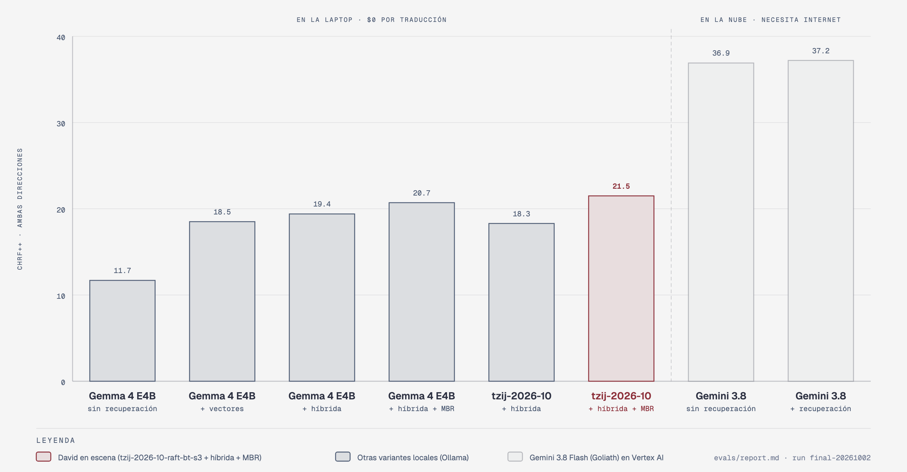

# Technical decisions

Why Tzij is built this way: the detail behind what the demo teaches, each decision with what was ruled out, the full `make eval` results and the versions. The iteration-by-iteration story, including what did not work, is in the [logbook](BITACORA.md) (Spanish). Back to the [README](../README.en.md). [Versión en español](DECISIONES.md).

## What you'll learn, in detail

| Lesson | Where it lives in the code |
| --- | --- |
| **Licensed web data and orthography normalization.** Every record carries `origin=web`, a URL and a license. Sources that don't allow this use are left out. Typographic single quotes, the saltillo `ꞌ`, `ʼ` and the other characters used as a glottal stop are unified to the ASCII apostrophe before indexing, training or evaluating. | [`data/SOURCES.md`](../data/SOURCES.md) (14 sources used, 14 needing permission, 28 rejected), [`pipeline/sources/`](../pipeline/sources/), [`data/normalize.py`](../data/normalize.py), [`tests/test_normalize.py`](../tests/test_normalize.py) |
| **Split by source, not by sentence.** A source is either entirely test or entirely training, and any training pair that repeats a test sentence is dropped. A random sentence split would measure memory. | [`pipeline/split.py`](../pipeline/split.py), [`pipeline/sources/__init__.py`](../pipeline/sources/__init__.py), [`data/DATASHEET.md`](../data/DATASHEET.md) |
| **An ablation decided by `make eval`.** Base + vectors → + hybrid retrieval → + RAFT fine-tune with back-translation → + MBR → + data in the test's domain (Bloom back-translation and distillation), plus Gemini with and without retrieval, on the same 600 sentences. Tuned on dev (since October 4 on `dev_domain`: BOUQuET paragraphs and Bloom pages outside the test sample), measured on test once. The best local variant with p50 ≤ 5 s wins, even if it isn't the one that took the most work. | [`evals/run_eval.py`](../evals/run_eval.py), [`evals/tune_retrieval.py`](../evals/tune_retrieval.py), [`duel/tzij_duel/variants.py`](../duel/tzij_duel/variants.py), [`evals/report.md`](../evals/report.md) |
| **Hybrid retrieval.** BM25 (FTS5) for rare words and EmbeddingGemma for meaning, fused with RRF; exact and fuzzy glossary lookup; the closest example goes last, right next to the sentence. | [`rag/retrieve.py`](../rag/retrieve.py), [`rag/store.py`](../rag/store.py), [`evals/tuning.md`](../evals/tuning.md) |
| **RAFT, back-translation and distillation: Goliath teaches once.** The fine-tune sees the same retrieved context David gets in the demo, without its own answer. Gemini translates licensed monolingual K'iche' into Spanish, and those pairs train both directions. It also distills: it writes everyday Spanish in the test's domains and translates it into K'iche' with David's context, and only pairs that pass the ALMG alphabet and the round trip are kept. All of it is used for training only, with origin, model, prompt, seed and cost recorded. | [`pipeline/train_set.py`](../pipeline/train_set.py), [`pipeline/monolingual.py`](../pipeline/monolingual.py), [`pipeline/back_translate.py`](../pipeline/back_translate.py), [`pipeline/distill.py`](../pipeline/distill.py) |
| **MBR.** 4 samples, and the one with the highest mean chrF++ against the others wins: the previous David's biggest single gain (+3.2), paid for in latency. | [`duel/tzij_duel/variants.py`](../duel/tzij_duel/variants.py) (`_mbr`) |
| **A pre-registered niche: translation memory.** One whole Pontoon product (Firefox Focus) is held out and the other products stay as translation memory. The rule, the product and the terms are published in git before anything is computed; chrF++ and WMT-style terminology accuracy are measured with a bootstrap. David wins there: 37.4 vs 28.9 (+8.5 [+4.7, +12.7]). | [`pipeline/niche.py`](../pipeline/niche.py), [`evals/niche.md`](../evals/niche.md), [`evals/niche_report.py`](../evals/niche_report.py), [`evals/niche_results.md`](../evals/niche_results.md) |
| **Token fertility.** In Gemma's tokenizer a K'iche' word costs 2.64 tokens and a Spanish word 1.41. The same sentence takes **1.92×** as many tokens in K'iche'. | [`evals/fertility.py`](../evals/fertility.py), [`evals/fertility.md`](../evals/fertility.md) |
| **A small model served in the cloud.** David, EmbeddingGemma and the index go inside one image, on a Cloud Run GPU with a minimum of 0 instances: nothing is billed while nobody uses the page, and the page wakes it up and waits until it's ready. | [`david/Dockerfile`](../david/Dockerfile), [`duel/tzij_duel/david_app.py`](../duel/tzij_duel/david_app.py), [`infra/20-david.sh`](../infra/20-david.sh), [`duel/tzij_duel/page.py`](../duel/tzij_duel/page.py) |
| **Automatic validation; native speakers optional.** Nobody has to review anything for the demo to work: each test pair is validated automatically (source-level split, cleaning, a 0.5–2.0 length ratio, the Spanish side looks Spanish, nothing repeated from train) and becomes `auto_validated`. Native review and the blind human evaluation (`make human-eval-sheet`) are optional extras. | [`pipeline/validate_test.py`](../pipeline/validate_test.py), [`pipeline/review.py`](../pipeline/review.py) (optional), [`evals/human_eval.md`](../evals/human_eval.md) (optional) |

## Decisions

### What runs where, and why

Everything runs on Google Cloud, project `ai-experiments-487722`. No model runs on the laptop: it only opens the page.

| Component | Where | Why |
| --- | --- | --- |
| The page (Next.js static export + FastAPI service, `page/`) | Cloud Run `tzij`, `europe-west4`, public, 1 vCPU | Opens from any browser, with nothing to run on talk day. For each sentence it asks David and Goliath separately, so each column fills as soon as its model answers, and for examples it measures closeness to the correct translation (chrF++). It stores nothing. |
| David (`tzij-2026-10-mix-s7` + EmbeddingGemma in Ollama, the index and MBR-4, `david/`) | Cloud Run `tzij-david`, `europe-west4`, private, 1× NVIDIA L4, 8 vCPU, 32 GiB, min 0 and max 1 instance | A GPU only while someone uses the page. The model (5.3 GB) and EmbeddingGemma go inside the image, so a cold start downloads nothing from the internet. Only the page's service account (`tzij-page`) has `run.invoker`. `europe-west4` because the project has L4 quota without zonal redundancy there. |
| Goliath (`gemini-3.8-flash`) | Vertex AI, `global`, called from the page | The frontier model as people use it, with no extra data. |
| Data pipeline | Cloud Run Job (`us-central1`) | It downloads about 1.5 GB (the Wiktionary dump is streamed and filtered) and has to be reproducible. It keeps the raw cache and versioned datasets in `gs://…-tzij-data`. `make data` runs the same code locally. |
| Retrieval index | `gs://…-tzij-data/index/<dataset>/`, inside David's image | Built with the same EmbeddingGemma that answers queries: `make index` uses the cloud one through `make david-proxy`. |
| LoRA fine-tune | Cloud Run Job with 1× NVIDIA L4 (`europe-west4`) | Serverless, billed per second, nothing left running between retrains. `TRAIN_RUNTIME=vertex` submits the same container as a Vertex AI Custom Job, and `train/colab.ipynb` wraps the same script for Colab Enterprise. |
| E4B merge and GGUF | Cloud Batch, one `n2-highmem-8` VM (64 GB) with a 200 GB disk, `europe-west4` | See below. |

### The page and David: how they connect

- **David is private.** The page calls `tzij-david` with an identity token from its service account (`duel/tzij_duel/remote.py`); nobody else can call it. The project owner can too, with `gcloud`: that's how `make examples`, `make eval` and `make index` run (`make david-proxy` opens his Ollama at `127.0.0.1:11434`).
- **Waking David up.** With min 0 instances, the GPU turns itself off about 15 minutes after the last request. The page asks `/api/david` every 3 s until David is ready (asking is what wakes him), shows «Preparando a David…» and doesn't let anyone translate until then. David's service opens its port right away, loads the model into the GPU, EmbeddingGemma and the index, does one full translation and only then says `ready` (`david_app.py`). A start from zero takes about 3 minutes. Afterwards the page asks once a minute while it's visible, which keeps him awake during the talk.
- **Why the page shows neither time nor cost.** On the L4, David answers in a median 0.9 s and Gemini in 2.0 s (33 translations of the examples), but he doesn't always win: in 7 of 33 he answered later. And in the cloud David costs about $0.0004 per translation (the instance bills $0.000395 per second: L4 + 8 vCPU + 32 GiB) and about $1.42 per hour while up, against about $0.0001 for Gemini. The page compares what David wins: the translation.
- **Discarded:** one instance with the page and David together (the page would take as long as the GPU to open), keeping David always on (about $1,000 a month) and serving David on CPU (MBR-4 with E4B takes tens of seconds).

### Why the E4B merge/GGUF runs on Cloud Batch

A Cloud Run GPU job has at most **32 GiB** of memory, and its filesystem lives in that same memory. Training E4B fits: the LoRA adapter is saved to a Cloud Storage volume. What doesn't fit is saving the 16 GB merged checkpoint and converting it to GGUF. The `tzij-2026-09` run trained 324 steps in 1,316 s (22 min). Then it ran out of memory while saving the merged model (`train/runs/tzij-2026-09.json`, ~30 min of job time, ~$0.70 estimated). So, with `TRAIN_FINISH=later`, the GPU job only trains the adapter, and `make train-finish` runs the same `train/finish.py`, with the same training image, on a Cloud Batch VM with 64 GB of RAM and a 200 GB disk (`infra/04-finish-batch.sh`). The VM is deleted when it ends. Tested on October 6, 2026 with the `tzij-2026-10-tm-a-e2-s4` adapter: 10 minutes end to end, a 5.3 GB Q4_K_M GGUF. A first run at 1.5 epochs was cancelled because, at ~4 s per step, it would not finish within Cloud Run's 1 h limit for a GPU task (`train/runs/failed/`).

RAFT prompts are longer (they carry the retrieved context), so one epoch doesn't fit in a 1 h task, and at batch 8 the L4 ran out of memory. `tzij-2026-10-raft-bt` trains with batch 2 × grad-accum 8, at most 1,024 tokens, in 4 chunks (`--shard i/4`): each chunk continues the previous chunk's adapter (`--init-adapter`). At the end, `make train-finish` merges the last chunk.

### BOUQuET: evaluation only, kept out of git

BOUQuET (Meta) is a multi-domain benchmark with human Spanish → K'iche' translations. It is gated on Hugging Face: you have to accept the terms, and the token lives in Secret Manager as `hf-token`. The terms allow **evaluation only** and private redistribution. So:

- it has the `test` role and never enters training or the index;
- its raw and processed data are gitignored and only exist in the private bucket;
- it is never projected: the page's examples come from Firefox Focus (Mozilla Pontoon, MPL-2.0). `make eval` does use it, along with the Bloom books.

### The 30% cap on religious text

The Totonicapán New Testament contributes about 8,000 verses, far more than all the everyday sentences combined. Without a cap, David would translate "¿Dónde está el mercado?" ("Where is the market?") in the voice of a gospel. `pipeline/split.py` caps religious text at 30% of training sentences. It picks the verses with a stable hash, so the selection is reproducible and spread out, and it never puts religious text in the test set. `pipeline/train_set.py` checks the cap again before fine-tuning. In the current dataset the share is exactly 30.0%.

### Gemini's K'iche' for training only, and filtered

Gemini does not master K'iche'. If it generated K'iche' unchecked, it would teach David its own mistakes. That's why every K'iche' record in the dataset, the index, dev and test is `origin=web`, with a URL and a license. There are two controlled exceptions, and both live only in the training files:

- **Back-translation:** Gemini translates licensed monolingual K'iche' sentences into **Spanish** (`origin=back_translated_gemini`, with model, prompt, seed and cost in `data/train/back_translated_gemini.meta.json`). The K'iche' side stays 100% human-written. Since October 4 the pairs train both directions: K'iche' → Spanish learns Gemini's Spanish for human-written K'iche'.
- **Distillation** (since October 4, `origin=distilled_gemini`, `pipeline/distill.py`): Gemini writes everyday Spanish in BOUQuET's domains and translates it into K'iche' with the same retrieved context David gets. Only pairs that use the ALMG alphabet, have a reasonable length and come back to Spanish with a chrF++ of at least the median of the dev pairs (46.6) are kept. 2,409 of the first 6,000 survived. A second batch (1,877 more pairs, $6.98, included in the ~$14 of Gemini and the ~$24.3 of the round) was generated but not used in `tzij-2026-10-mix-s7`. Dictionary-anchored synthetic data did not help and its code was removed ([logbook, section 7](BITACORA.md), Spanish); distillation in the test's domain did (+2.1 on `dev_domain`, [section 11](BITACORA.md)). The sources that pair Spanish and K'iche' through English (Pontoon, GATITOS) are independent human translations, with no machine translation involved. Even mock mode (`MOCK_AI=1`) answers with text from the licensed data, never with made-up K'iche'. `HuggingFaceFW/finetranslations` was rejected because it is machine translation.

### EmbeddingGemma + `sqlite-vec`

- **Why:** they fit in a single SQLite file that can be copied, is versioned per dataset and travels inside David's image. EmbeddingGemma is served by the same Ollama as David, on the same GPU. It uses the task prefix `task: sentence similarity | query: ` because it compares input sentences with source sentences in the same language.
- **How:** two lookups per query. **Examples** come from a hybrid search: BM25 over FTS5 (finds rare words and names) and embedding neighbors (find meaning), fused with Reciprocal Rank Fusion and filtered by direction. The **glossary** first looks for exact matches of the whole input, its bigrams and its single words, then fuzzy matches (spelling variants), and fills up with the same hybrid search. David gets `RAG_K=6` of each kind, with the closest example last, right next to the sentence (`RAG_ORDER=best_last`, +1.7 on dev). All of it was tuned with `make tune-retrieval` on the dev split. An on-disk embedding cache (`rag/.cache/`) makes rebuilding cheap.
- **Rejected:** a separate embedding API. It would add a network call per query, and the index has to be built with the same model that queries it.
- **Rejected: EmbeddingGemma 2** (tried on October 7). With the same David and the index rebuilt with its vectors it dropped on dev (38.8 vs 39.9) and on the test set (23.9 vs 25.8); on the specialty it gained 1.7, within how much MBR varies. Also, in Ollama it only runs on the MLX runtime, which the L4 doesn't have ([logbook, section 13](BITACORA.md), Spanish).

### Other decisions

- **chrF++, not BLEU.** It gives partial credit for character n-grams in an agglutinative language with lots of spelling variation. It is computed at corpus level on normalized text, with the same apostrophe for everyone.
- **Same instructions for every model** (`tzij-translate-v1`). Only the context block changes, so the comparison measures data, not prompting.
- **David's latency includes retrieval**, because whoever watches the page waits for it too.
- **MBR in the demo, behind a flag.** With `DAVID_MBR=1` David generates `MBR_SAMPLES=4` translations at temperature 0.7 and keeps the one with the highest mean chrF++ against the others. On the laptop p50 was 4.1 s; on the L4, 0.9 s, because Ollama runs the 4 samples in parallel (`OLLAMA_NUM_PARALLEL=4`). `DAVID_MBR=0` goes back to a single sample.
- **`OLLAMA_NUM_CTX=4096`.** The 128k default reserves a huge KV cache and evicts EmbeddingGemma on every request.
- **No logit bias, no multi-prompt MBR.** Both were tried with llama-server: the bias cost 1.2 on dev and multi-prompt MBR went over the 5 s limit; their code was removed ([logbook, section 8](BITACORA.md), Spanish).

## Results

**With an organization's translation memory, David beats Goliath:** on Firefox Focus, a product he never saw, he scores **37.4 chrF++** against **28.9** (+8.5 [+4.7, +12.7]). In general translation Goliath stays ahead: **36.9** against **25.7**. Repeated on October 7 with David on the cloud GPU: 35.3 vs 28.9 on Firefox Focus (+6.4 [+2.5, +10.5]), 36.5 vs 30.4 on 105 newer Firefox Focus sentences (+6.1 [+3.0, +9.2]) and 25.8 on the general test ([logbook, section 13](BITACORA.md), Spanish). On Mozilla Monitor's new strings, a marketing website, Goliath wins (32.6 vs 22.0); the demo doesn't use them. This repo is the half of the talk about *when NOT to fine-tune* and *what each step buys you*: retrieval is the biggest jump, and the fine-tune only started to pay off once its data looked like the test's domain. Goliath teaches once (back-translation and distillation) and afterwards David translates without it.

`make eval`, run `final-20261002`, dataset `20261002-173447` (the demo's; its test split is identical to that of `20261002-022500`, where the rows before `mix-s7` were run). 600 test sentences (150 per source and direction, from Bloom and BOUQuET) that are never in the index or in training. The Gemma variants were measured on the laptop (Apple Silicon, Ollama), before David moved to the cloud: «Where» and the latencies come from that run. References are `auto_validated` (`pipeline/validate_test.py`). Retrieval was tuned on the dev split only ([`evals/tuning.md`](../evals/tuning.md)); the test set was used once, for these numbers.

| Variant | Where | Retrieval | es → quc | quc → es | Both | p50 | p95 | API / 1,000 |
| --- | --- | --- | ---: | ---: | ---: | ---: | ---: | ---: |
| Gemma 4 E4B (`gemma4:e4b`) | laptop | no | 7.5 | 16.7 | 11.7 | 1.31 s | 3.6 s | $0 |
| Gemma 4 E4B | laptop | vector | 18.2 | 18.8 | 18.5 | 1.84 s | 4.8 s | $0 |
| Gemma 4 E4B | laptop | hybrid | 19.0 | 19.8 | 19.4 | 1.75 s | 4.7 s | $0 |
| Gemma 4 E4B + MBR (4 samples) | laptop | hybrid | 20.4 | 20.9 | 20.7 | 4.59 s | 16.3 s | $0 |
| `tzij-2026-10-raft-bt-s3` (LoRA, RAFT + back-translation, 1 epoch) | laptop | no | 9.2 | 17.4 | 13.0 | 1.20 s | 4.6 s | $0 |
| `tzij-2026-10-raft-bt-s3` | laptop | hybrid | 18.4 | 18.3 | 18.3 | 1.72 s | 4.7 s | $0 |
| `tzij-2026-10-raft-bt-s3` + MBR (4) — previous David | laptop | hybrid | 21.9 | 21.2 | 21.5 | 3.96 s | 14.2 s | $0 |
| `tzij-2026-10-mix-s7` (2 epochs without Focus + Bloom back-translation + distillation) | laptop | hybrid | 26.9 | 23.2 | 25.1 | 1.64 s | 4.3 s | $0 |
| **`tzij-2026-10-mix-s7` + MBR (4) — the demo's David** | laptop | hybrid | 27.0 | 24.3 | **25.7** | 4.14 s | 13.4 s | $0 |
| **Gemini 3.8 Flash — Goliath** | cloud | no | 33.4 | 40.7 | **36.9** | 1.73 s | 4.7 s | $0.29 |
| Gemini 3.8 Flash | cloud | vector | 34.6 | 40.1 | 37.2 | 2.08 s | 6.5 s | $0.95 |

**Ablation: what each step bought** (same 600 sentences):

| Step | Both | Δ | p50 |
| --- | ---: | ---: | ---: |
| Base E4B + vector retrieval | 18.5 | — | 1.84 s |
| + hybrid retrieval (BM25 + vectors with RRF, fuzzy glossary, tuned on dev) | 19.4 | +0.9 | 1.75 s |
| + RAFT fine-tune with Gemini back-translation | 18.3 | −1.1 | 1.72 s |
| + MBR (4 samples; keep the one with the highest mean chrF++ against the others) | 21.5 | +3.2 | 3.96 s |
| + data without Focus, 2 epochs, Bloom back-translation and distillation ([logbook, section 11](BITACORA.md)) | **25.7** | +4.1 | 4.14 s |

**Takeaways:**

- **Where David holds a translation memory Goliath lacks, he wins.** In the niche (Firefox Focus, 144 sentences David never saw, neither in the index nor in training, with Mozilla's other products in his index) he scores 37.4 against 28.9: +8.5 with 95% CI [+4.7, +12.7]. Without MBR, +7.0 [+2.9, +11.1]. On terminology they tie: 61% vs 46%, +15 with an interval that includes zero. The base model with the same index uses the right term 78% of the time, but ties on chrF++ (30.2). The niche was pre-registered in [`evals/niche.md`](../evals/niche.md); numbers in [`evals/niche_results.md`](../evals/niche_results.md).
- **In general, Goliath is still the better translator.** David trails by 11.2 points (15.4 with the previous David) and in every slice (length, direction, source, domain): the gap is general K'iche', not a slice ([logbook, section 10](BITACORA.md)). He beats Goliath on 130 of 599 sentences (22%) and is within 5 points on 206 (34%). A bigger Goliath changes nothing: `gemini-3.1-pro-preview` ties `gemini-3.8-flash` in K'iche'.
- **Data is still what moves David.** Retrieval takes E4B from 11.7 to 18.5, and in Spanish → K'iche', the direction a model can't fake, from 7.5 to 18.2. Hybrid search adds +0.9: BM25 finds the rare words embeddings miss.
- **MBR was the biggest gain with the previous David (+3.2), paid for in latency.** David generates 4 translations and keeps the one most similar to the others. With the current David it adds +0.6 on test (25.1 → 25.7) and +1.5 on the niche (+7.0 → +8.5). On the laptop p50 went from 1.6 to 4.1 s and p95 to 13 s; on the Cloud Run L4 the median is 0.9 s. It turns off with `DAVID_MBR=0`.
- **The first fine-tune, with retrieval, did not help: −1.1.** RAFT trains with the same retrieved context David sees in the demo, without the answer in it. Combined with MBR it added +0.8 over the base model with MBR (21.5 vs 20.7). Its data (UD, Pontoon, COERLL) did not look like the test.
- **The fine-tune pays off when the data looks like the domain.** With Bloom back-translated in both directions and distillation in BOUQuET's domains, `tzij-2026-10-mix-s7` beats the base model with the same retrieval by +5.7 (25.1 vs 19.4) and by +5.0 with MBR (25.7 vs 20.7). Against the previous David: +4.1 [+3.6, +4.7].
- **Goliath teaches once; afterwards David translates without it.** Gemini translated 405 licensed monolingual K'iche' sentences (K'iche' Wikipedia, Space Scoop) into Spanish: 399 pairs for a one-time **$0.12**. At the same training budget (1/4 epoch) back-translation added +1.1 (15.7 vs 14.6), and that first fine-tune cost **$3.09** across 5 L4 jobs. Later it translated the K'iche'-only Bloom books ($0.36, 1,998 pairs) and distilled 2,409 pairs in the test's domains. The data round that produced the current David cost about **$24.3** ($8.52 of L4; [logbook, section 11](BITACORA.md)). None of it enters test or the index.
- **In the cloud, David isn't cheaper.** On the laptop he cost $0 per translation; on the Cloud Run L4, about $0.0004, against about $0.0001 for Gemini (about $0.0002 once Gemini's list price doubles on January 1, 2027). The demo compares the translation.
- Gemini with the same retrieval barely improves (36.9 → 37.2) and costs more than 3× as much because of the longer prompt.

Breakdown by source, length, domain and failures in [`evals/report.md`](../evals/report.md). Token fertility in [`evals/fertility.md`](../evals/fertility.md). Data and limits in [`MODEL_CARD.md`](../MODEL_CARD.md).

### In the demo

*A Firefox Focus example on the page. At the top, the correct translation, made by people for
Mozilla Pontoon (MPL-2.0); in each column, the translation and how close it is to the correct one
(chrF++). The translations are **model output**.*

## Versions

None of the preview APIs this talk series tracks (AppFunctions, WebMCP, UCP, AP2, A2A, MCP SDK, ADK) is used in this repo. Versions verified on September 30, 2026:

| Piece | Version |
| --- | --- |
| Goliath | `gemini-3.8-flash`, Vertex AI `global`, `thinking_level=low`, `google-genai` SDK 2.25.0 |
| David | `tzij-2026-10-mix-s7` (LoRA on `google/gemma-4-E4B-it`, GGUF Q4_K_M) on Ollama 0.35.0, Cloud Run with 1× NVIDIA L4 (`europe-west4`) |
| Other measured variants (`evals/runs/final-20261002`) | `gemma4:e4b` (base), `tzij-2026-10-raft-bt-s3` (the previous David), `tzij-2026-10-raft-bt-s0` and `tzij-2026-10-raft-s0` (1/4 epoch, to isolate back-translation) |
| Embeddings | `embeddinggemma` on Ollama |
| Python | 3.12 with uv 0.8.22: FastAPI 0.142.2, uvicorn 0.54.0, sacrebleu 2.6.0, sqlite-vec 0.1.9, tokenizers 0.23.2, huggingface-hub 1.33.0, google-cloud-storage 3.15.1, pytest 9.1.1 |
| Web | Node 24.21.0, npm 12.0.2, Next.js 16.3.8, React 19.3.0, TypeScript 5.9.3, vitest 3.2.7, Playwright 1.63.0 |
| Training image | torch 2.14.0 (CUDA 12.6), transformers 5.17.0, peft 0.21.1, trl 1.14.1, accelerate 1.15.0, datasets 5.0.1, llama.cpp `b11292` |
| Google Cloud SDK | 587.0.0 |

No model name is hard-coded: every model comes from `.env` (`GEMINI_MODEL`, `LOCAL_MODEL_TAG`, `BASE_MODEL_TAGS`, `FINETUNED_MODEL_TAGS`, `GEMMA_BASE_MODEL`, `EMBEDDING_MODEL`).
