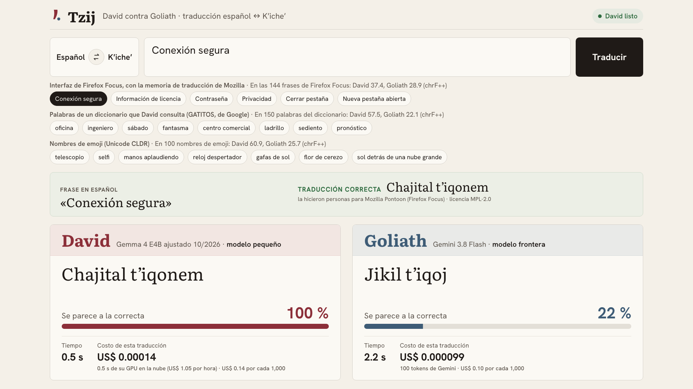
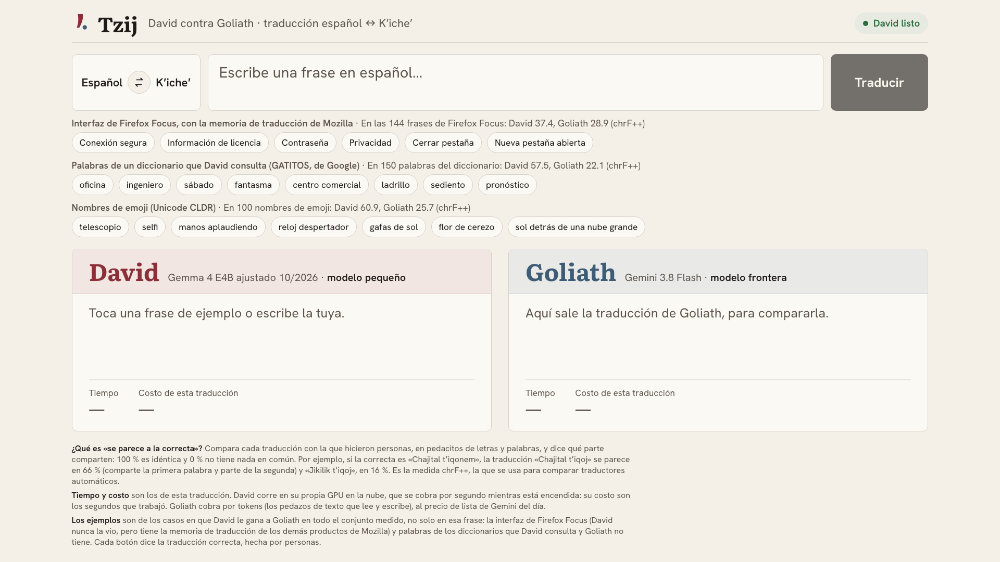
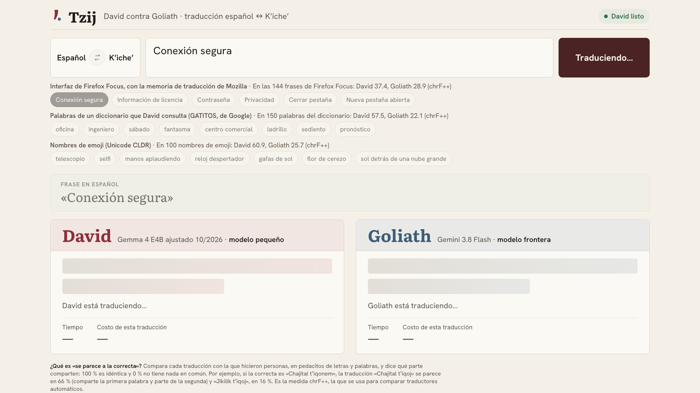
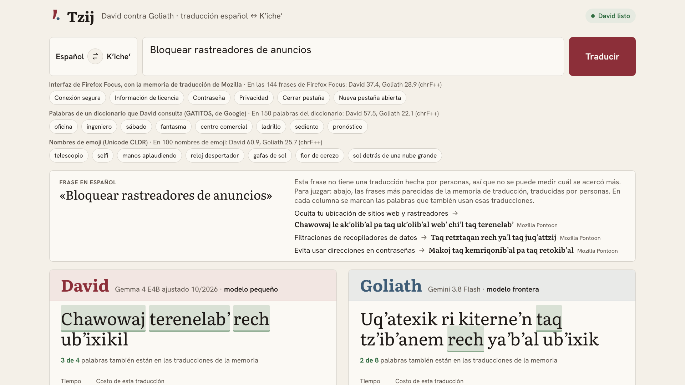
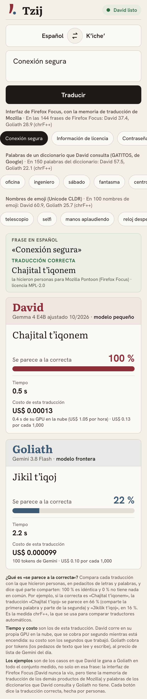

# Demo script — Tzij

One page, in the cloud: you type a Spanish sentence (or tap an example) and, at the same time,
**David**, a fine-tuned Gemma 4 E4B (`tzij-2026-10-mix-s7`) with its translation memory, and
**Goliath**, Gemini 3.8 Flash, translate it into K'iche'. The two translations appear side by side,
each with how long it took and what it cost. For the examples, the page also shows the correct
translation, made by people, and how close each one got to it.

Length: about 3 minutes. [Versión en español](DEMO.md). *The UI is in Spanish; the lines to say
are given in Spanish, as in the talk.*



## Before the talk

Nothing to run. About 5 minutes before, open in Chrome, full screen (`⌃⌘F`):

```
https://tzij-611681112050.europe-west4.run.app
```

(`make page-url` prints it.) The page wakes David up: his cloud GPU turns itself off when nobody
uses it. While it starts, the top right says «Preparando a David…» and the buttons wait; it takes
about 40 s (39 s measured with the GPU off; it used to be 3 min 24 s). When it says **«David listo»**, it's ready. While the page stays open, David stays awake.

The page also works well on a phone: if you want the audience to try it, the same address works
there.

## On stage

### 1. The page (30 s)



- **What you see:** the text box, the examples in three groups (Firefox Focus interface, words from a
  dictionary and emoji names), each with its result on the whole set and the two columns: David, a small model, and Goliath, a frontier model.
- **What to say:** "A la izquierda, David: un modelo pequeño, ajustado con datos Kʼicheʼ con
  licencia. A la derecha, Goliath: Gemini. Los dos van a traducir lo mismo, del español al
  Kʼicheʼ, el idioma maya más hablado de Guatemala."

### 2. Two examples (1 min 30 s)




- **What to do:** tap **Conexión segura**. Each column fills when its model answers. Then tap
  **gafas de sol**, from the emoji names.
- **What you see:** at the top, the correct translation. In each column, the translation, how close
  it is to the correct one, how long it took and what it cost. For «Conexión segura», David 100 %
  and Goliath between 8 and 26 %; for «gafas de sol», David 100 % and Goliath between 16 and 32 %. David usually answers in under a second; Goliath, in one or two.
- **What to say:** "Son frases de Firefox Focus, el navegador de Mozilla. La traducción correcta la
  hicieron personas, y ninguno de los dos la vio. David tiene la memoria de traducción de los demás
  productos de Mozilla: las palabras que esa comunidad ya decidió. Por eso se acerca más, y además
  responde antes. Lo mismo con un diccionario: David consulta el suyo."
- **If someone asks what «se parece a la correcta» is:** "Compara cada traducción con la de las
  personas en pedacitos de letras y palabras: 100 % es idéntica. Se llama chrF++." (The page's
  footer explains it with an example.)
- **If someone asks about cost:** "Goliath cobra por frase y David por hora de GPU. Con una persona
  usándolo, Gemini sale más barato por frase; con miles de frases por hora y la tarifa de Gemini de
  2027, que es el doble, sale más barato David." Numbers in the
  [README](../README.en.md#projections-cost-and-time).

### 3. A typed sentence (1 min)



- **What to do:** type a short sentence of the same kind, text from an app or a browser (for
  example `Bloquear rastreadores de anuncios`), and press **Traducir** (or `Enter`).
- **What you see:** both translations, with time and cost. If the sentence is in the licensed data,
  the page recognizes it and measures it like an example. If not, it says there's nothing to
  measure against and, to help judge, shows the 3 closest translation-memory sentences, translated
  by people, and marks in each column the words those translations also use.
- **What to say:** "No hace falta que sea un ejemplo: escribo lo que quiera y los dos lo traducen.
  Las palabras marcadas son las que la comunidad de Mozilla ya usa para cosas parecidas."

## The talk's numbers

| | David | Gemini 3.8 Flash |
| --- | ---: | ---: |
| Translation memory: Firefox Focus, 144 sentences David never saw (chrF++, pre-registered) | **37.4** | 28.9 |
| The same, repeated with David in the cloud | **35.3** | 28.9 |
| 105 Firefox Focus sentences newer than the dataset, in the cloud | **36.5** | 30.4 |
| Time per translation on the page, median (26 examples × 3) | **0.81 s** | 1.47 s |

The first row is the pre-registered measurement (+8.5, 95 % CI +4.7 to +12.7,
[`evals/niche_results.md`](../evals/niche_results.md)); the other two repeat it with David in the
cloud (+6.4 and +6.1). Time: David answered first in 74 of 78 translations.

General translation (the full test set, both directions) is not part of the talk, because Gemini
wins there (36.9 vs 25.7). Neither is cost with little use, where Gemini is cheaper. Both are in the
[README](../README.en.md#experiments), with every experiment and the projections, and in
[BITACORA.md](BITACORA.md) (Spanish). For the same reason the page also translates K'iche' →
Spanish (the ⇄ button), but that direction is not shown in the talk.

## The example sentences

They only come from use cases David wins as a whole set, not from single sentences: the Firefox
Focus interface (6 strings, from 144 where David scores 37.4 and Goliath 28.9), everyday words from
the GATITOS dictionary (8, from 150: 57.5 vs 22.1) and emoji names from Unicode CLDR (7, from 100:
60.9 vs 25.7). They live in [`duel/examples.json`](../duel/examples.json), with their correct
translation, source, license and the measured translations and scores. Each was translated 3 times
by the cloud David and by Goliath; only the ones where, all 3 times, David stayed close to the
correct one (chrF++ 50 or more) and at least 15 points closer than Goliath were kept. To re-check
them: `make examples`.


## On a phone



On narrow screens everything goes in one column, David above Goliath, and the examples scroll
sideways.

## If something fails

| What happens | What to do |
| --- | --- |
| Still says «Preparando a David…» after 3 minutes | Reload the page. After 6 minutes the page says «David no responde: recarga la página». |
| A column says «No pudo traducir esta frase» | Tap the example again. |
| A column says «No hay conexión con la página» | The venue's internet went down: wait for it and reload. |
