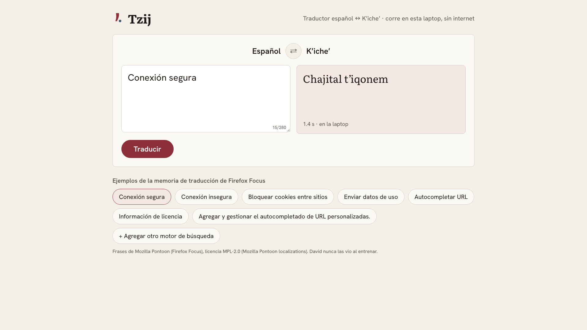
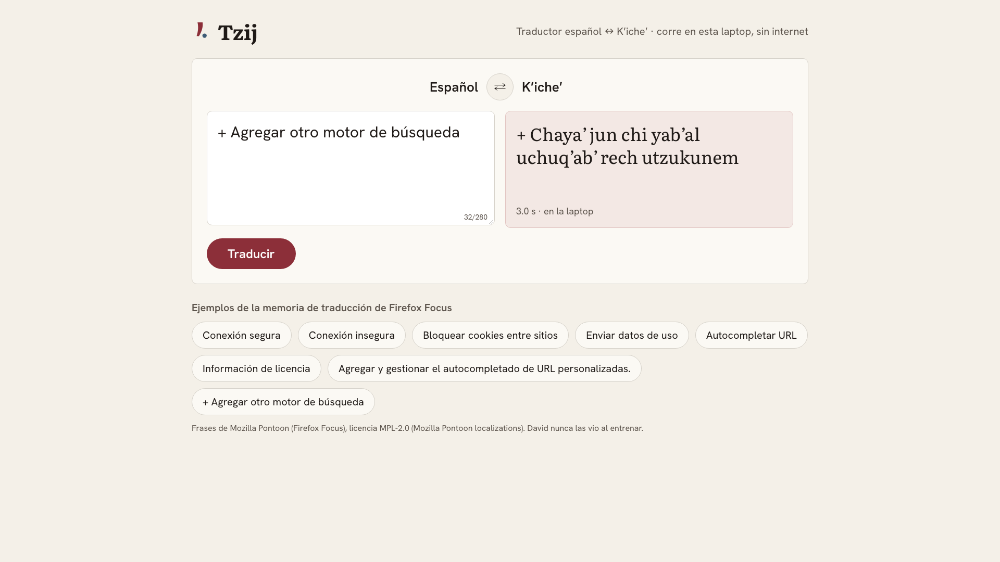

# Demo script — Tzij on stage

One page: David's translator. David is a fine-tuned Gemma 4 E4B (`tzij-2026-10-mix-s7`) with its
retrieval index and translation memory, running on the laptop with no internet. You type a Spanish
sentence (or tap an example), press **Traducir** and the K'iche' translation appears.

Length: about 3 minutes. [Versión en español](DEMO.md)



## Before the talk

1. **Once, with internet**, if the laptop doesn't have the data and the model yet:

   ```bash
   make data-pull && make niche-data
   make pull-model TAG=tzij-2026-10-mix-s7
   ```

2. **Start Tzij.** In one terminal:

   ```bash
   make up
   ```

3. **Warm up and check.** In another terminal:

   ```bash
   make stage-on && make warmup && make preflight
   ```

   `warmup` loads David and its index so the first translation isn't cold. `preflight` checks the
   model, the index, the page and the example phrases: it translates one live and compares it with
   its reference translation. It must end in "preflight ok"; each `[FALLA]` says how to fix it.

4. **Open the page** in Chrome, full screen (`⌃⌘F`):

   ```
   http://127.0.0.1:8787/traductor/
   ```

5. **Notifications and screen saver off:** "Do Not Disturb" and `caffeinate -d &`.

After the talk: `make stage-off` (in Tzij it only confirms there is nothing in the cloud).

## On stage

### 1. The page (30 s)


- **On screen:** the box to type in, the translation box and the examples below.
- **Say:** "This is David: a small model running on this laptop, with no internet. It translates
  Spanish into K'iche', the most widely spoken Mayan language in Guatemala."

### 2. An example (1 min)


- **Do:** tap **Conexión segura**, then **Bloquear cookies entre sitios**. Each translation takes
  2 or 3 seconds.
- **Say:** "These are sentences from Firefox Focus, Mozilla's browser. People translated it into
  K'iche', and David never saw that translation while training. What it does have is the
  translation memory of Mozilla's other products: the words that community already chose. With
  that memory, David translates these sentences better than Gemini."

### 3. A typed sentence (1 min)



- **Do:** type a short sentence of the same kind, text from an app or a browser, for example
  `+ Agregar otro motor de búsqueda`, and press **Traducir** (or `Enter`).
- **Say:** "It doesn't have to be an example: I type whatever I want and David translates it right
  here, for free and without sending the text anywhere."

### 4. No internet (30 s)

- **Do:** turn the laptop's Wi-Fi off and tap another example, for example **Conexión insegura**.
- **Say:** "Without a network David works the same: the model, the translation memory and the index
  live on this laptop. Each translation costs zero."
- Turn the Wi-Fi back on afterwards.

## The talk's numbers

Only the cases David wins:

| | David (laptop) | Gemini 3.8 Flash (cloud) |
| --- | ---: | ---: |
| Translation memory: Firefox Focus, 144 sentences (chrF++) | **37.4** | 28.9 |
| Cost per 1,000 translations | **$0** | $0.29 |
| No internet | **still translates** | doesn't translate |

General translation (the full test set, both directions) is not part of the talk because Gemini
wins it. It is documented with its numbers in [DECISIONES.en.md](DECISIONES.en.md#results) and
[BITACORA.md](BITACORA.md) (Spanish). For the same reason, the page also translates K'iche' into
Spanish (with the ⇄ button), but that direction is not shown in the talk.

## The example phrases

They live in [`duel/examples.json`](../duel/examples.json), with their reference translation,
source (Mozilla Pontoon, Firefox Focus) and license (MPL-2.0). Each one was translated live by
David 3 times, and every translation stayed close to the reference (chrF++ of 50 or more). To check
them again, for example after changing David:

```bash
make examples
```

## If something fails

| What happens | What to do |
| --- | --- |
| The page doesn't open | `make up` in a terminal and reload. |
| It says "David no pudo traducir" | `ollama list`; if the model is missing, `make pull-model TAG=tzij-2026-10-mix-s7`, then `make up`. |
| The first translation takes more than 10 s | It was cold: wait, the next one is fast. Next time run `make warmup` first. |
| The examples don't show | `make preflight` says what's missing (`make examples` or `make web`). |
| Everything fails | Rehearsal without models: `make up MOCK_AI=1` (David answers with examples from the licensed data). |
