# Guion de la demo — Tzij en el escenario

Paso a paso para mostrar a David (Gemma 4 E4B ajustado, en la laptop) contra Goliath (Gemini 3.8
Flash, en la nube). Cada paso es una pantalla, con las teclas exactas, la frase que se escribe, la
idea que se dice y el tiempo esperado. Las capturas son de la variante de escenario
(`tzij-2026-10-mix-s7` + recuperación híbrida + MBR-4, `make demo-screens`, 5 de octubre de 2026).
Las traducciones que se ven en ellas son **salida del modelo, sin validar**.

Duración total: unos 6 minutos (8 con el teléfono validador).

## Antes de la demo

- [ ] **Datos, índice y modelos al día** (una vez, con internet):

  ```bash
  make data-pull && make niche-data
  make pull-model TAG=tzij-2026-10-mix-s7
  ```

  `make data-pull` baja `20261002-173447`, el dataset en escena: ya trae el mazo
  `test_niche.jsonl` de la ronda de especialidad (Firefox Focus fuera de train y del índice).
  `make niche-data` construye el índice. Si `data/processed/LATEST` ya es `20261002-173447` y
  `make preflight` sale en verde, no hace falta nada de esto.

- [ ] **Levantar todo.** En una terminal:

  ```bash
  make up
  ```

- [ ] **Precalentar y revisar.** En otra terminal:

  ```bash
  make stage-on && make warmup && make preflight
  ```

  `stage-on` solo avisa que Tzij no tiene nada en la nube (la secuencia es la misma en todos los
  repos). `warmup` carga David y EmbeddingGemma y hace una traducción de David con recuperación y
  MBR, y una llamada a Goliath, para que la primera ronda no sea en frío. `preflight` revisa
  Ollama y los modelos, el índice contra el dataset, los mazos de evaluación y de especialidad, el
  duelo, Gemini, el disco y que la mediana de 3 traducciones de David quede dentro de 5 s. También falla si
  `LOCAL_MODEL_TAG` es un David que entrenó con Firefox Focus (`tzij-2026-10-raft-bt-s3`, por
  ejemplo): con él la ronda de especialidad (`S`) no vale. `tzij-2026-10-mix-s7` nunca vio Focus.
  Tiene que terminar en «preflight ok»; cada `[FALLA]` dice cómo arreglarlo.
- [ ] **Ventanas:**
  - **Proyector:** Chrome en pantalla completa (`⌃⌘F`) con `http://127.0.0.1:8787/presentador/`.
    Tiene que ser `127.0.0.1` y no la IP de la LAN, porque los controles solo responden desde la
    laptop.
  - **Laptop (pantalla espejo apagada):** una terminal con los logs de `make up` y este guion.
  - **Teléfono o emulador (opcional):** el QR de la esquina abre `/validar/`.
- [ ] **Prueba sin Wi-Fi.** Apaga el Wi-Fi de verdad y haz una ronda: Goliath tiene que decir
  "Sin conexión" y David tiene que traducir. Vuelve a encender el Wi-Fi y espera a que la píldora
  diga "En línea". Para ensayar sin tocar el sistema existe el interruptor "Simular sin Wi-Fi
  (ensayo)" en la barra de comandos (`/`).
- [ ] **Marcador en cero** justo antes de subir:

  ```bash
  make reset
  ```

- [ ] **Brillo, notificaciones y salvapantallas apagados.** Usa "No molestar" y
  `caffeinate -d &`.

Después de la charla: `make stage-off` (en Tzij solo lo confirma: no hay nada en la nube que bajar).

## Teclas en el escenario

| Tecla | Qué hace |
| --- | --- |
| `E` | Frase de evaluación (del conjunto de prueba, con referencia y chrF++) |
| `S` | Ronda de especialidad: memoria de traducción (Firefox Focus, siempre español → Kʼicheʼ) |
| `D` | Cambia la dirección (español → Kʼicheʼ / Kʼicheʼ → español) |
| `/` | Barra de comandos: escribir una frase en vivo, simular sin Wi-Fi, reiniciar |
| `M` | Ficha del modelo |
| `Esc` | Cierra la barra o la ficha |

## Paso 1 — El escenario listo

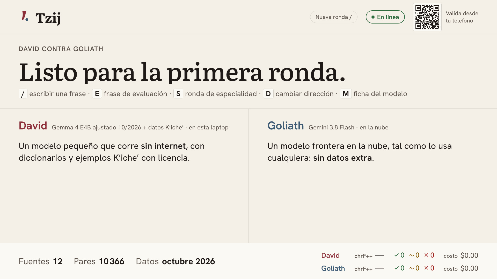

- **Teclas:** ninguna. La pantalla ya está así después de `make reset`.
- **Idea:** "A la izquierda, David: un modelo pequeño que corre en esta laptop. A la derecha,
  Goliath: el modelo grande, en la nube."
- **Tiempo:** 30 s.

## Paso 2 — Ronda de evaluación, español → Kʼicheʼ

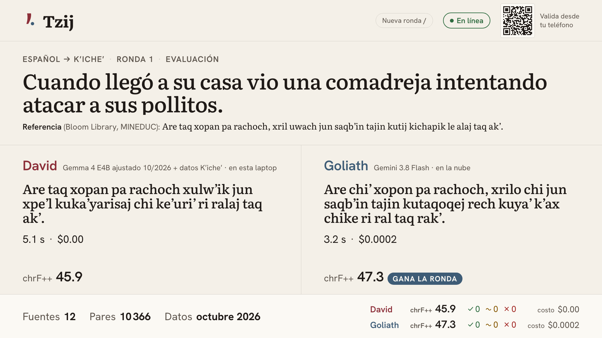

- **Teclas:**

  ```
  E
  ```

- **Idea:** "La frase y su referencia vienen de un libro con licencia del Ministerio de Educación.
  Ninguno de los dos la vio antes; chrF++ mide qué tanto se parece cada traducción a la
  referencia."
- **Tiempo:** 45 s. David tarda de 2 a 7 s según el largo de la frase (p50 en la prueba: 4.1 s)
  porque genera 4 candidatos y elige el de consenso (MBR). Goliath tarda de 1 a 3 s.

## Paso 3 — Kʼicheʼ → español

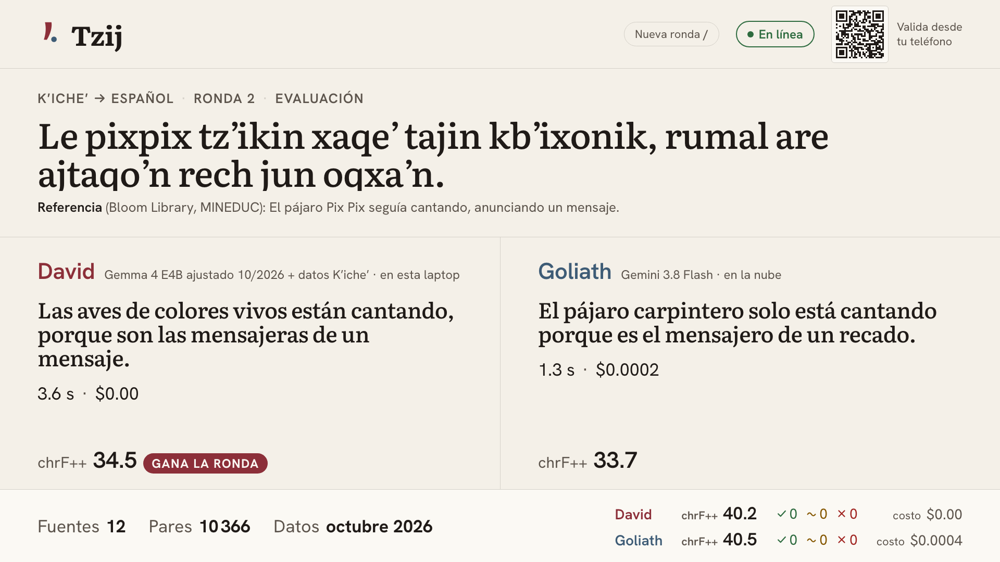

- **Teclas:**

  ```
  D
  E
  ```

- **Idea:** "En esta dirección Goliath lee Kʼicheʼ y escribe en el idioma que domina; aquí la
  brecha es más grande."
- **Tiempo:** 30 s.

## Paso 4 — Ronda de especialidad

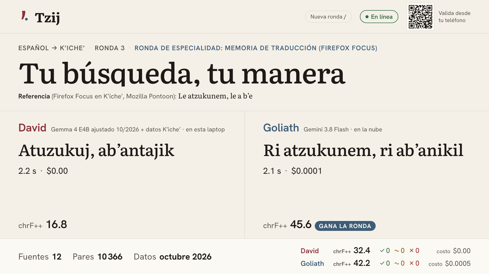

- **Teclas:**

  ```
  D
  S
  ```

  `D` vuelve a español → Kʼicheʼ (`S` siempre usa esa dirección). Pulsa `S` dos o tres veces: el
  resultado es el de las 144 frases y una frase sola puede salir para cualquiera de los dos. La
  primera del mazo («Tu búsqueda, tu manera», la de la captura) suele ganarla Goliath.
- **Idea:** "Firefox Focus en Kʼicheʼ. David nunca vio este producto, pero tiene la memoria de
  traducción de los demás productos de Mozilla. En las 144 frases David le gana a Goliath: 37.4
  contra 28.9 de chrF++, +8.5 puntos, y gana 81 frases contra 60 de Goliath. Lo definimos antes de
  ver los resultados."
- **Tiempo:** 1 min.

## Paso 5 — En vivo, una frase corta

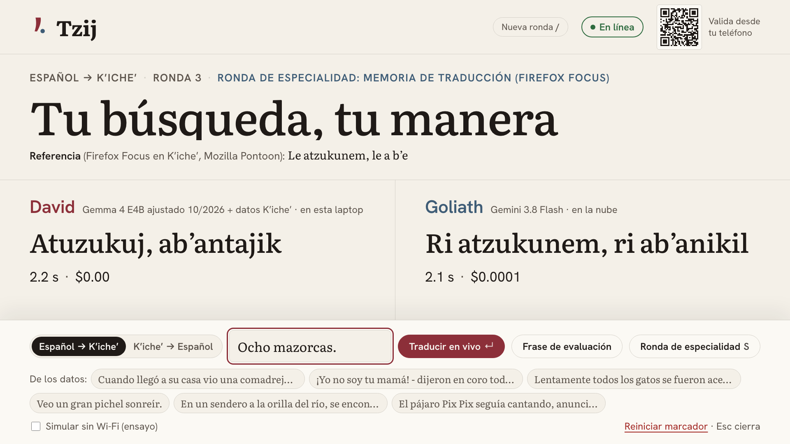

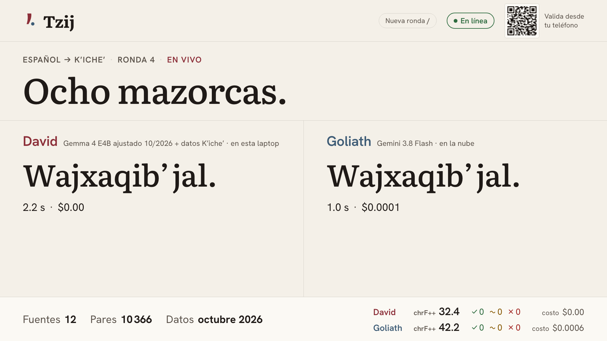

- **Teclas y frase** (de un libro de Bloom Library, CC BY 4.0):

  ```
  /
  Ocho mazorcas.
  ↵
  ```

  Otras frases cortas de los datos con licencia, por si hay tiempo: `Siete calcetines.`,
  `Son seis piedras.`, `¡Con gusto!`
- **Idea:** "En frases cortas es donde David más se acerca a Goliath."
- **Tiempo:** 30 s.

## Paso 6 (opcional) — El teléfono validador

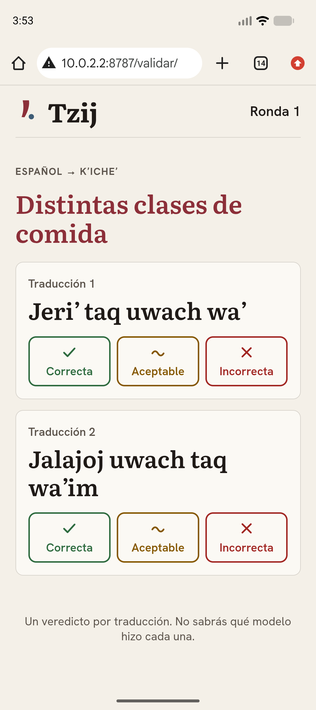

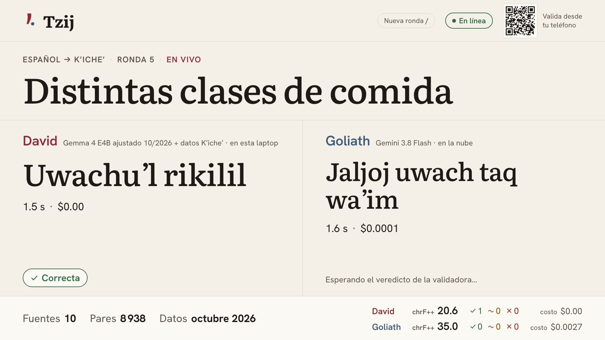

- **Teclas y frase:**

  ```
  /
  Distintas clases de comida
  ↵
  ```

  En el teléfono se toca un veredicto. Para ensayar con el emulador:

  ```bash
  adb shell am start -a android.intent.action.VIEW \
    -d http://10.0.2.2:8787/validar/ com.android.chrome
  ```

  El emulador llega a la laptop por `10.0.2.2`. Un teléfono real usa el QR.
- **Idea:** "Una persona hablante vota sin saber cuál traducción es de quién. Su voto aparece aquí
  en menos de un segundo."
- **Tiempo:** 1 min 30 s.

## Paso 7 — Sin internet

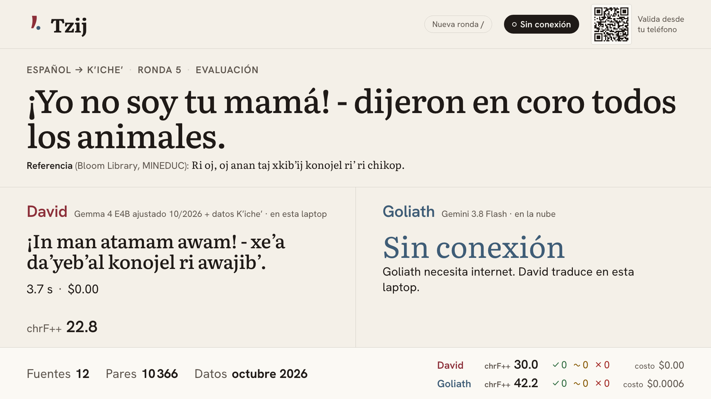

- **Teclas:** apaga el Wi-Fi de la laptop y pulsa

  ```
  E
  ```

  Si el Wi-Fi del lugar es poco confiable, usa el interruptor de ensayo: `/`, marca "Simular sin
  Wi-Fi (ensayo)", `Esc`, `E`.
- **Idea:** "Sin red, Goliath no existe. David sigue igual: el modelo, el índice y los embeddings
  están en esta laptop."
- **Tiempo:** 45 s. Vuelve a encender el Wi-Fi (o desmarca el interruptor) antes del siguiente paso.

## Paso 8 — Kʼicheʼ → español en vivo

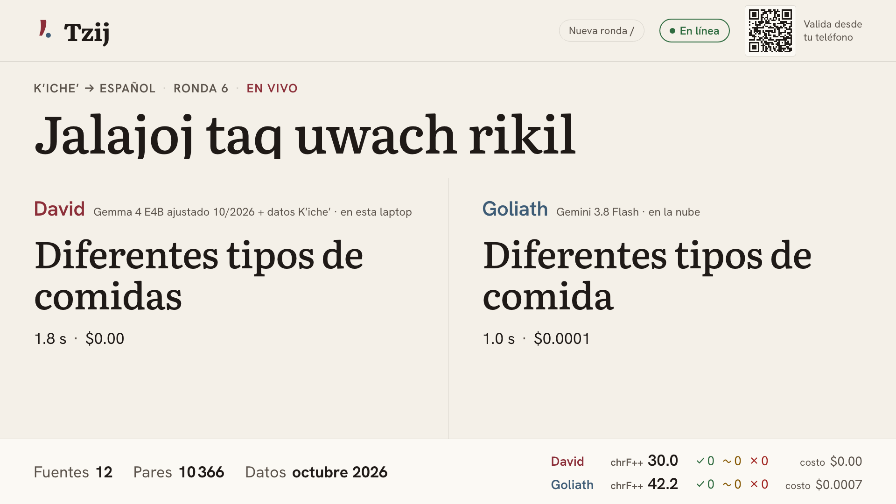

- **Teclas y frase** (Bloom Library, CC BY 4.0):

  ```
  D
  /
  Jalajoj taq uwach rikil
  ↵
  ```

- **Idea:** "La frase en Kʼicheʼ sale de nuestros datos con licencia: no inventamos Kʼicheʼ en el
  escenario."
- **Tiempo:** 30 s.

## Paso 9 — Ficha del modelo

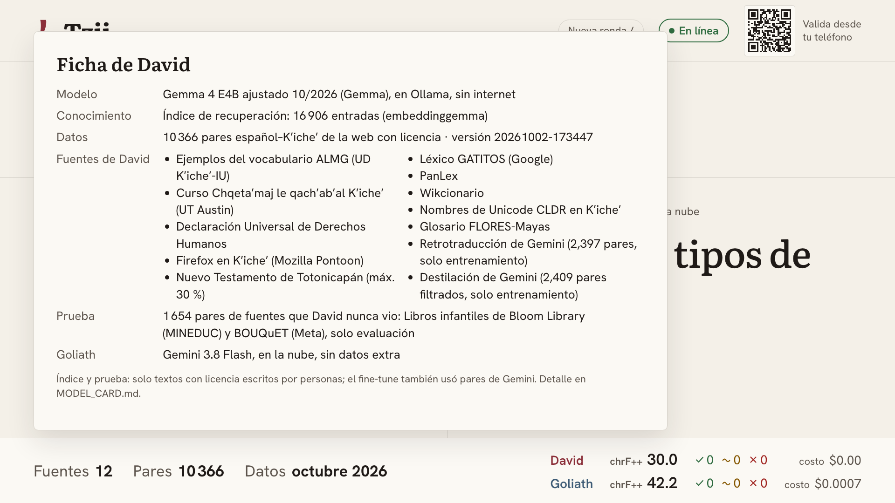

- **Teclas:**

  ```
  M
  ```

  `Esc` la cierra.
- **Idea:** "Qué sabe David y desde cuándo: las fuentes con licencia y las fechas de los datos."
- **Tiempo:** 30 s.

## Paso 10 — Resultados y bitácora


- **Teclas:** cambia a la diapositiva de resultados. La gráfica es `docs/diagrams/bitacora.png` y
  la historia completa está en [`BITACORA.md`](BITACORA.md).
- **Idea:** "Cada mejora de David vino de datos o de cómo los usa: de 11.7 a 25.7. Goliath enseña
  una vez en la nube; David sirve para siempre sin internet. Con la memoria de traducción de una
  organización, David gana (+8.5). En traducción general, Goliath sigue arriba por 11.2 puntos,
  y un Gemini más grande no traduce mejor Kʼicheʼ: el techo es cuánto Kʼicheʼ hay en la web."
- **Tiempo:** 1 min.

## Si algo falla

| Síntoma | Acción |
| --- | --- |
| La pantalla dice "No hay conexión con el servicio del duelo" | `make up` en la terminal; la página se reconecta sola. |
| David tarda más de 15 s en la primera ronda | Estaba en frío. Espera esa ronda, después `make reset`. La próxima vez precalienta (ver arriba). |
| David dice "error" en todas las rondas | `ollama list`; si falta el modelo, `make pull-model TAG=tzij-2026-10-mix-s7`. Para seguir ya: `LOCAL_MODEL_TAG=gemma4:e4b make up`. |
| "recuperación: …" en el lado de David | Ollama no sirve `embeddinggemma`: `ollama pull embeddinggemma` y `make up`. |
| Aviso de índice en la barra de comandos | El índice no es del dataset actual: `make index` (unos minutos) o sigue; las rondas funcionan. |
| Goliath "Sin conexión" con Wi-Fi encendido | Revisa que "Simular sin Wi-Fi (ensayo)" esté desmarcado (`/`). Si no, la red del lugar bloquea Vertex AI: úsalo como el momento offline. |
| "No quedan frases de evaluación/especialidad" | `/` → "Reiniciar marcador", o `make reset`. |
| El teléfono no abre el QR | Que esté en la misma red; si la IP detectada es otra, `PUBLIC_URL=http://<ip>:8787 make up`. |
| El voto no aparece en el proyector | El validador solo vota en rondas en vivo (`/`), no en las de evaluación. |
| La ronda se queda en "traduciendo" | Espera 30 s. Si sigue, `make reset` y repite. Con MBR apagado (`MBR_ON_STAGE=0 make up`) David responde en ~2 s. |
| Todo falla | Ensayo sin nube ni GPU: `make up MOCK_AI=1` (David responde con ejemplos de los datos con licencia). |
