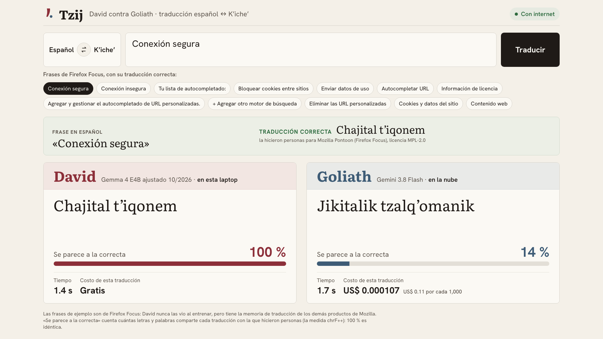
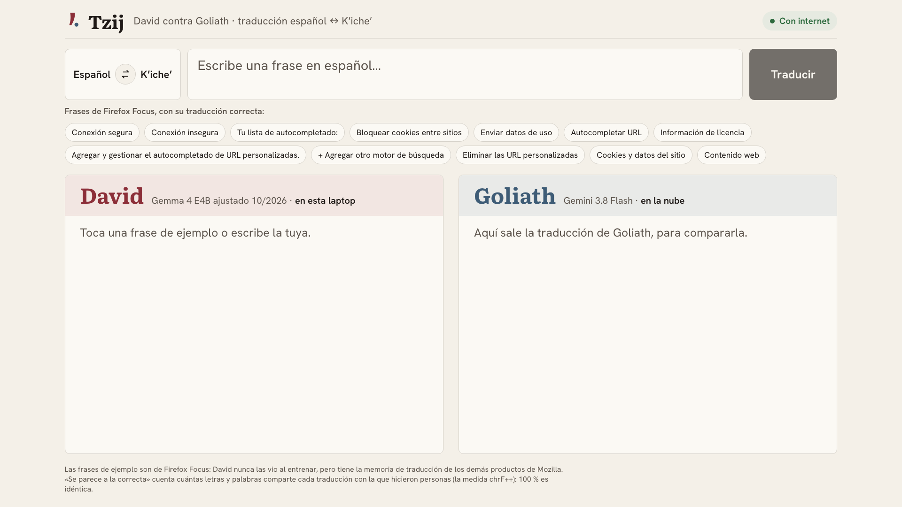
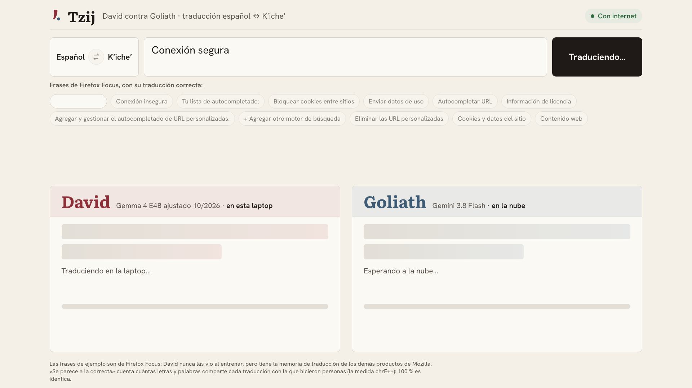
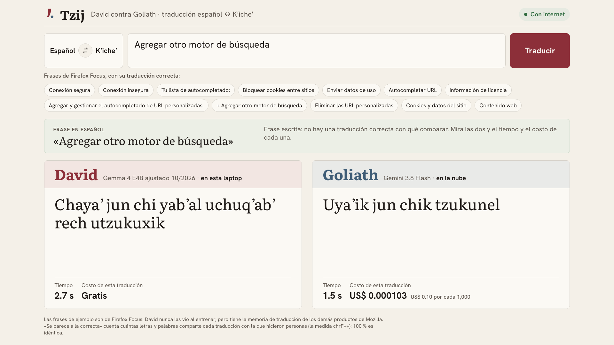
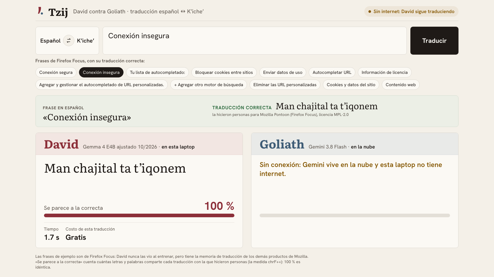

# Guion de la demo — Tzij en el escenario

Una sola página: el traductor. Se escribe una frase en español (o se toca un ejemplo) y, al mismo
tiempo, la traducen al Kʼicheʼ **David**, Gemma 4 E4B ajustado (`tzij-2026-10-mix-s7`) con su
memoria de traducción, que corre en esta laptop sin internet, y **Goliath**, Gemini 3.8 Flash en la
nube. Las dos traducciones salen lado a lado, cada una con su tiempo y su costo. En los ejemplos,
la página muestra también la traducción correcta, la que hicieron personas, y qué tanto se parece
a ella cada una.

Duración: unos 4 minutos. [English version](DEMO.en.md)



## Antes de la charla

1. **Una vez, con internet**, si la laptop no tiene ya los datos y el modelo:

   ```bash
   make data-pull && make niche-data
   make pull-model TAG=tzij-2026-10-mix-s7
   ```

2. **Levantar Tzij.** En una terminal:

   ```bash
   make up
   ```

3. **Precalentar y revisar.** En otra terminal:

   ```bash
   make stage-on && make warmup && make preflight
   ```

   `warmup` carga a David y su índice y hace una llamada a Gemini, para que la primera traducción
   no salga en frío. `preflight` revisa el modelo, el índice, la página y los ejemplos: traduce uno
   en vivo con los dos y comprueba que David quede cerca de la traducción correcta y claramente
   más cerca que Goliath. Tiene que terminar en «preflight ok»; cada `[FALLA]` dice cómo
   arreglarlo. Sin internet, lo de Gemini sale como `[aviso]`, no como falla.

4. **Abrir la página** en Chrome, en pantalla completa (`⌃⌘F`):

   ```
   http://127.0.0.1:8787/traductor/
   ```

5. **Notificaciones y salvapantallas apagados:** «No molestar» y `caffeinate -d &`.

Después de la charla: `make stage-off` (en Tzij solo lo confirma: no hay nada en la nube que bajar).

## En el escenario

### 1. La página (30 s)



- **Qué se ve:** el cuadro para escribir, las frases de ejemplo y, abajo, las dos columnas: David
  (en esta laptop) y Goliath (en la nube).
- **Qué decir:** "A la izquierda, David: un modelo pequeño que corre en esta laptop. A la derecha,
  Goliath: Gemini, en la nube. Los dos van a traducir lo mismo, del español al Kʼicheʼ, el idioma
  maya más hablado de Guatemala."

### 2. Un ejemplo (1 min 30 s)




- **Qué hacer:** toca **Conexión segura**. Cada columna se llena cuando su modelo responde, en 1 a
  3 segundos. Después toca **Bloquear cookies entre sitios**.
- **Qué se ve:** arriba, la traducción correcta. En cada columna, la traducción, qué tanto se parece
  a la correcta (por ejemplo, David 100 % y Goliath 22 %), el tiempo y el costo: «Gratis» para
  David y unos centésimos de centavo para Goliath.
- **Qué decir:** "Son frases de Firefox Focus, el navegador de Mozilla. La traducción correcta la
  hicieron personas, y ninguno de los dos la vio. David tiene la memoria de traducción de los demás
  productos de Mozilla: las palabras que esa comunidad ya decidió. Por eso se acerca más. Y lo hace
  gratis."

### 3. Una frase escrita (1 min)



- **Qué hacer:** escribe una frase corta del mismo tipo, texto de una aplicación o de un navegador,
  por ejemplo `Agregar otro motor de búsqueda`, y pulsa **Traducir** (o `Enter`).
- **Qué se ve:** las dos traducciones, el tiempo y el costo. Como es una frase escrita, no hay
  traducción correcta con qué comparar.
- **Qué decir:** "No hace falta que sea un ejemplo: escribo lo que quiera, y David lo traduce aquí
  mismo, sin mandar el texto a ninguna parte."

### 4. Sin internet (1 min)



- **Qué hacer:** apaga el Wi-Fi de la laptop y toca **Conexión insegura**.
- **Qué se ve:** arriba a la derecha, «Sin internet: David sigue traduciendo». Goliath dice «Sin
  conexión» y David traduce igual.
- **Qué decir:** "Sin red, Goliath no existe. David sigue: el modelo, la memoria de traducción y el
  índice viven en esta laptop."
- Vuelve a encender el Wi-Fi al terminar.

## Los números de la charla

| | David (laptop) | Gemini 3.8 Flash (nube) |
| --- | ---: | ---: |
| Memoria de traducción: Firefox Focus, 144 frases (chrF++) | **37.4** | 28.9 |
| Costo por 1,000 traducciones | **$0** | $0.29 |
| Sin internet | **traduce igual** | no traduce |

La traducción general (el conjunto de prueba completo, en las dos direcciones) no es parte de la
charla, porque ahí gana Gemini (36.9 contra 25.7). Está en el [README](../README.md#experimentos),
con todos los experimentos, y en [BITACORA.md](BITACORA.md). Por la misma razón, la página también
traduce del Kʼicheʼ al español (con el botón ⇄), pero esa dirección no se muestra en la charla.

## Las frases de ejemplo

Están en [`duel/examples.json`](../duel/examples.json), con su traducción correcta, su fuente
(Mozilla Pontoon, Firefox Focus), su licencia (MPL-2.0) y las traducciones y puntajes medidos. Cada
una se tradujo en vivo 3 veces con David y con Goliath; quedaron solo las que, las 3 veces, David
tradujo cerca de la correcta (chrF++ de 50 o más) y por lo menos 15 puntos más cerca que Goliath.
Para volver a revisarlas, por ejemplo después de cambiar de modelo:

```bash
make examples
```

## Si algo falla

| Qué pasa | Qué hacer |
| --- | --- |
| La página no abre | `make up` en una terminal y recarga. |
| Una columna dice «No hay conexión con el servicio de Tzij» | El servicio se cayó: `make up` y vuelve a tocar el ejemplo. |
| David dice «No pudo traducir esta frase» | `ollama list`; si falta el modelo, `make pull-model TAG=tzij-2026-10-mix-s7` y `make up`. |
| Goliath dice «Sin conexión» con el Wi-Fi encendido | La red del lugar bloquea Vertex AI: úsalo como el momento sin internet. |
| La primera traducción de David tarda más de 10 s | Estaba en frío: espera, la siguiente sale rápido. La próxima vez corre `make warmup` antes. |
| No aparecen los ejemplos | `make preflight` dice qué falta (`make examples` o `make web`). |
| Todo falla | Ensayo sin modelos: `make up MOCK_AI=1` (los dos responden con ejemplos de los datos con licencia). |
