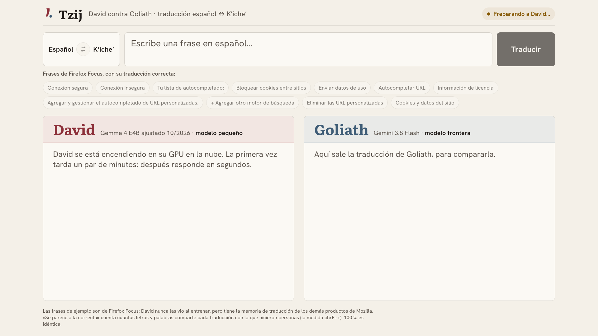

# Guion de la demo — Tzij

Una sola página, en la nube: se escribe una frase en español (o se toca un ejemplo) y, al mismo
tiempo, la traducen al Kʼicheʼ **David**, Gemma 4 E4B ajustado (`tzij-2026-10-mix-s7`) con su
memoria de traducción, y **Goliath**, Gemini 3.8 Flash. Las dos traducciones salen lado a lado. En
los ejemplos, la página muestra también la traducción correcta, la que hicieron personas, y qué
tanto se parece a ella cada una.

Duración: unos 3 minutos. [English version](DEMO.en.md)


## Antes de la charla

No hay que correr nada. Unos 5 minutos antes, abre en Chrome, en pantalla completa (`⌃⌘F`):

```
https://tzij-611681112050.europe-west4.run.app
```

(`make page-url` la imprime.) La página despierta a David: su GPU en la nube se apaga sola cuando
nadie la usa. Mientras arranca, arriba a la derecha dice «Preparando a David…» y los botones
esperan; tarda unos 3 minutos. Cuando dice **«David listo»**, ya está. Mientras la página siga
abierta, David se queda despierto.



## En el escenario

### 1. La página (30 s)


- **Qué se ve:** el cuadro para escribir, las frases de ejemplo y las dos columnas: David, un
  modelo pequeño, y Goliath, un modelo frontera.
- **Qué decir:** "A la izquierda, David: un modelo pequeño, ajustado con datos Kʼicheʼ con
  licencia. A la derecha, Goliath: Gemini. Los dos van a traducir lo mismo, del español al
  Kʼicheʼ, el idioma maya más hablado de Guatemala."

### 2. Dos ejemplos (1 min 30 s)


- **Qué hacer:** toca **Conexión segura**. Cada columna se llena cuando su modelo responde. Después
  toca **Información de licencia**.
- **Qué se ve:** arriba, la traducción correcta. En cada columna, la traducción y qué tanto se
  parece a la correcta: en «Conexión segura», David 100 % y Goliath entre 12 y 16 %; en
  «Información de licencia», David alrededor de 70 % y Goliath entre 9 y 17 %.
- **Qué decir:** "Son frases de Firefox Focus, el navegador de Mozilla. La traducción correcta la
  hicieron personas, y ninguno de los dos la vio. David tiene la memoria de traducción de los demás
  productos de Mozilla: las palabras que esa comunidad ya decidió. Por eso se acerca más."

### 3. Una frase escrita (1 min)


- **Qué hacer:** escribe una frase corta del mismo tipo, texto de una aplicación o de un navegador,
  y pulsa **Traducir** (o `Enter`).
- **Qué se ve:** las dos traducciones, lado a lado. Como es una frase escrita, no hay traducción
  correcta con qué comparar.
- **Qué decir:** "No hace falta que sea un ejemplo: escribo lo que quiera y los dos lo traducen."

## Los números de la charla

| | David | Gemini 3.8 Flash |
| --- | ---: | ---: |
| Memoria de traducción: Firefox Focus, 144 frases que David nunca vio (chrF++) | **37.4** | 28.9 |

+8.5 puntos, con un intervalo de confianza del 95 % de +4.7 a +12.7 ([`evals/niche_results.md`](../evals/niche_results.md)).

La traducción general (el conjunto de prueba completo, en las dos direcciones) no es parte de la
charla, porque ahí gana Gemini (36.9 contra 25.7). Está en el [README](../README.md#experimentos),
con todos los experimentos, y en [BITACORA.md](BITACORA.md). Por la misma razón la página también
traduce del Kʼicheʼ al español (con el botón ⇄), pero esa dirección no se muestra en la charla.

## Las frases de ejemplo

Están en [`duel/examples.json`](../duel/examples.json), con su traducción correcta, su fuente
(Mozilla Pontoon, Firefox Focus), su licencia (MPL-2.0) y las traducciones y puntajes medidos. Cada
una se tradujo 3 veces con el David de la nube y con Goliath, como lo hace la página; quedaron solo
las que, las 3 veces, David tradujo cerca de la correcta (chrF++ de 50 o más) y por lo menos 15
puntos más cerca que Goliath. Son 11. Para volver a revisarlas, por ejemplo después de cambiar de
modelo: `make examples`.

## Si algo falla

| Qué pasa | Qué hacer |
| --- | --- |
| Sigue diciendo «Preparando a David…» después de 5 minutos | Recarga la página. Si pasa de 6 minutos, la página dice «David no responde: recarga la página». |
| Una columna dice «No pudo traducir esta frase» | Vuelve a tocar el ejemplo. |
| Una columna dice «No hay conexión con la página» | El internet del lugar se cayó: espera a que vuelva y recarga. |
