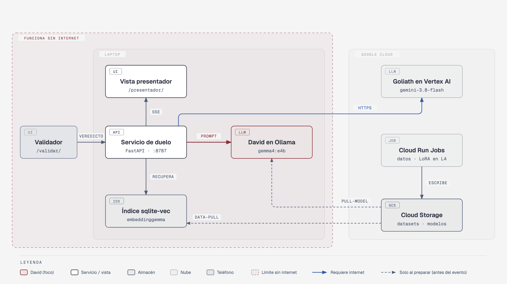
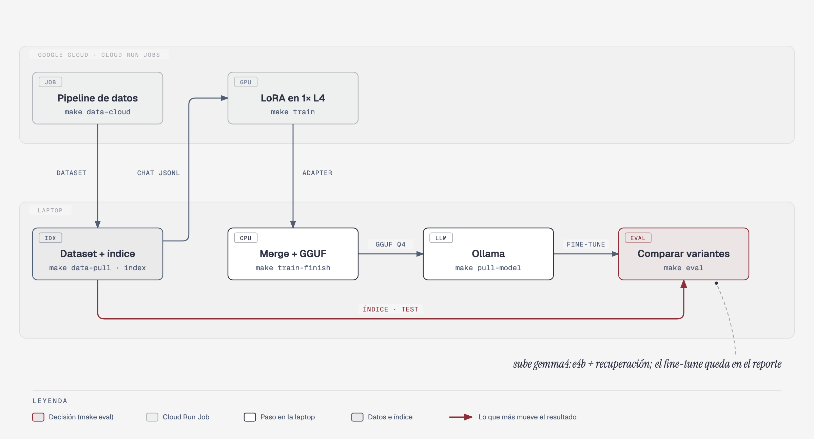

# Estructura del repositorio

Qué corre dónde y dónde está cada cosa en el código. Volver al [README](../README.md). [English version](ESTRUCTURA.en.md).

## Arquitectura



Todo corre en Google Cloud (proyecto `ai-experiments-487722`); la laptop solo abre la página.

- **La página** (Cloud Run `tzij`, `europe-west4`, pública): la exportación estática de `web/` y su servicio en Python (`duel/tzij_duel/page.py`). Por cada frase pide la traducción de David y la de Goliath por separado, así cada columna se llena en cuanto su modelo responde, y mide los dos tiempos desde el mismo lugar.
- **David** (Cloud Run `tzij-david`, `europe-west4`, privado, 1× NVIDIA L4): Ollama con `tzij-2026-10-mix-s7` (LoRA sobre Gemma 4 E4B, Q4_K_M) y EmbeddingGemma, el índice de recuperación (SQLite con `sqlite-vec` y FTS5) y la decodificación MBR-4, en un solo contenedor (`david/Dockerfile`, servicio `duel/tzij_duel/david_app.py`), con los kernels de GPU que CUDA compiló para la L4 (`david/warm_cache.py`, `david/Dockerfile.cache`). También responde, para las frases escritas, si están en los datos con licencia y qué frases de la memoria se les parecen (`duel/tzij_duel/evidence.py`). Solo la cuenta de servicio de la página puede llamarlo. Se apaga solo cuando nadie usa la página (mínimo 0 instancias) y la página lo despierta al abrirse.
- **Goliath:** `gemini-3.8-flash` en Vertex AI (`global`), llamado desde el servicio de la página.
- **Datos y entrenamiento:** un Cloud Run Job arma los datasets en Cloud Storage; el fine-tune corre en un Cloud Run Job con una L4, y el merge + GGUF de E4B en una VM de Cloud Batch con 64 GB. Los modelos quedan en el bucket de modelos y la imagen de David los lleva adentro.

Fuente de los diagramas: [`diagrams/`](diagrams/) (HTML, SVG y PNG).

## Pipeline



## Mapa del repositorio

```
data/          normalize.py (ortografía), SOURCES.md, DATASHEET.md (generado)
pipeline/      run.py → sources/ (una por fuente) → clean.py → split.py → manifest/datasheet
               validate_test.py (validación automática), review.py / apply_review.py (revisión nativa opcional)
               train_set.py (JSONL de chat, RAFT), monolingual.py + back_translate.py (retrotraducción), distill.py (destilación),
               niche.py (la especialidad: Firefox Focus fuera de train, `make niche-data`)
               Dockerfile + cloudbuild.yaml (imagen del Cloud Run Job de datos)
rag/           embedder.py (EmbeddingGemma vía Ollama), store.py (sqlite-vec),
               build_index.py, retrieve.py (híbrida BM25 + vectores con RRF, ejemplos + glosario)
duel/
  duel_core/   clientes de Ollama y Gemini, chrF++, costo, conectividad
  tzij_duel/   page.py (servicio de la página), david_app.py (servicio de David en la GPU), remote.py (la página llama a David
               con un token de identidad), variants.py, prompts.py, examples.py, settings.py, dataset.py
  examples.json  frases de ejemplo de la página (`make examples`), revisadas contra David en la nube y Goliath
david/         Dockerfile (Ollama + modelos + índice + servicio), cloudbuild.yaml, start.sh,
               warm_cache.py + Dockerfile.cache + cloudbuild-cache.yaml (kernels de GPU compilados una vez),
               bench.py + bench-results.json (tiempo, costo y capacidad medidos)
page/          Dockerfile (Next.js exportado + servicio de la página), cloudbuild.yaml
evals/         run_eval.py → report.md, tune_retrieval.py → tuning.md, niche_report.py → niche_results.md,
               fertility.py → fertility.md, human_eval.md
train/         train_lora.py (TRL + PEFT → merge → GGUF), finish.py (adaptador → GGUF), submit_job.py (Cloud Run Jobs),
               chain.sh (trozos que siguen el adaptador anterior), colab.ipynb, runs/
infra/         env.sh, 00-project.sh, 01-train-service-account.sh, 02-train-image.sh, 03-train-job.sh,
               04-finish-batch.sh (merge de E4B en Cloud Batch), 10-data-job.sh, 20-david.sh, 21-page.sh
web/           Next.js: app/page.tsx (la página), lib/translator.ts, components/Brand.tsx, tests/
tests/         pruebas del pipeline, normalización, recuperación y fertilidad
docs/          ONBOARDING.md, DEMO.md (+ .en), BITACORA.md, DECISIONES.md, COMANDOS.md, ESTRUCTURA.md, CREDITOS.md,
               diagrams/, demo/ (toda traducción en una captura es salida del modelo, sin validar)
MODEL_CARD.md  qué es David, con qué datos, resultados y límites
```

Archivos generados que no se suben a git: `data/raw/`, `data/processed/`, `data/review/`, `data/train/`, `rag/index/`, `evals/runs/`, `web/out/`.
